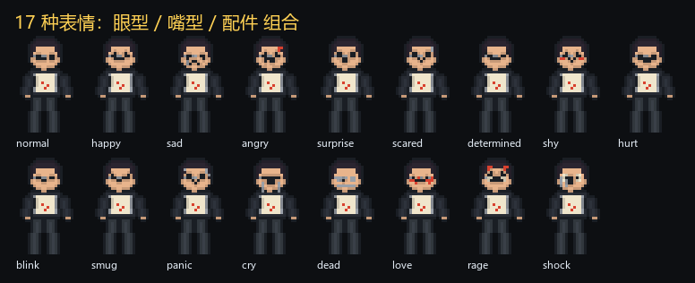
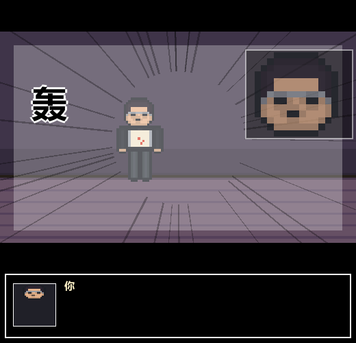
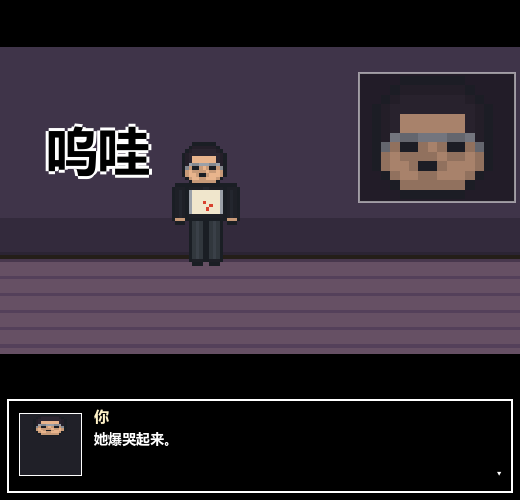
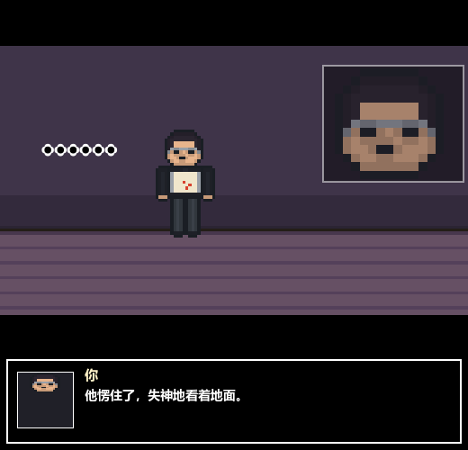

# 17 种表情 + 夸张漫画面

> 动画分支（`animation`）。在原有 10 表情上加 7 个「夸张漫画面相」，
> 并给用力过猛的那几种配冲击帧：白闪、集中线、抖屏、拟声词、反应大脸。



## 表情谱

| 组 | 表情 | 眼睛 | 嘴 | 配件 |
| --- | --- | --- | --- | --- |
| 基础 | normal | 2×2 方块 | 线 | — |
| | happy | 上挑弧 | 宽笑 | — |
| | sad | 下垂弧 | 耷拉 | 泪 |
| | angry | 压扁 + 压低眉 | 龇牙 | 青筋 |
| | surprise | 睁大 2×2 | 圆 O | — |
| | scared | 睁大 | 波浪 | 汗 |
| | determined | 平线 + 高眉 | 平嘴 | — |
| | shy | 上挑弧 | 波浪 | 脸红 |
| | hurt | X 眼 | 张口 | — |
| | blink | 1px 横线 | 线 | — |
| 夸张 | **smug** 得意 | 单侧斜眼 | 单边上挑 | — |
| | **panic** 慌乱 | 睁大 | 波浪 | 双汗滴 |
| | **cry** 爆哭 | 闭眼 | 大洞 | 两道泪 |
| | **dead** 失神 | 灰色空洞 | 小点 | 眼下阴影 |
| | **love** 心动 | **红色心形眼** | 宽笑 | 脸红 |
| | **rage** 暴怒 | 白眼 + 竖眉 | 裂口带牙 | 双青筋 |
| | **shock** 惊呆 | 全白眼 + 小瞳 | 竖圆口 | 脸颊竖线 |

全部是「眼型 × 嘴型 × 配件」的组合，和原来的绘制语言一致，没有换画风——只是把幅度拉大。

## 夸张演出：哪些表情会「炸」

| 表情 | 白闪 | 抖屏 | 推镜 | 拟声词 |
| --- | --- | --- | --- | --- |
| rage | 0.55 | 9.0 | +0.30 | 轰 |
| shock | 0.60 | 8.0 | +0.28 | ！！ |
| panic | — | 6.0 | +0.14 | 哗 |
| hurt | 0.20 | 5.0 | +0.14 | ！ |
| angry | — | 4.0 | +0.12 | 哼 |
| cry | — | 4.0 | +0.16 | 呜哇 |
| love | 0.35 | — | +0.18 | 咚 |
| dead | — | — | −0.10 | …… |

冲击帧由四层叠出来：

1. **白闪**：场景整体压白，0.6 秒内衰减。
2. **集中线**：34 条从画面中心放射的黑线，随冲击强度淡出。
3. **抖屏**：整个场景按 sin/cos 高频位移，幅度随衰减归零。
4. **反应大脸**：小人在 24×36 里只有 11px 头，表情看不清——所以冲击时在右侧**切一张 150px 的大脸**（从 `_head_{expr}` 取），像漫画的反应格。







## 优先级与规则

- beat 显式 `expr` > 关键词表 > `normal`。
- 关键词表按「越夸张越先判」排序：`dead > cry > rage > hurt > panic > scared > shock > smug > love > angry > surprise > sad > shy > determined > happy`。
- 一句里同时出现「哭」和「笑」时，先演更用力的那个。

## 生成方式

17 种表情、12 个角色（6 段主角 + 6 个 NPC）都是程序画的，不是手绘贴图：

```bash
python tools/make_frames.py
```

脚本会重写 `assets/chars/*`、`data/frames.json`，并输出 `docs/frame-sheet.png`。
表情只烘焙在 idle 第 0 帧，其余帧用 normal 省体积；NPC 现在也有全部 17 张表情头和表情帧。

## 验证

```bash
godot --headless --path . --script res://test/text_sync_smoke.gd
godot --headless --path . --script res://test/cutscene_smoke.gd
```

截图：

```bash
godot --path . --script res://tools/capture_impact.gd -- <输出目录>
```

## 还差的

- 夸张只作用在「说话人」身上；如果一句话里两个人同时有反应，只能演一个。
- 反应大脸固定切右下角，没有做「从画面外滑入」的位移缓动（目前是淡入）。
- 没有「汗滴/青筋飞出去」这类脱离身体的特效件，配件仍画在脸上。
