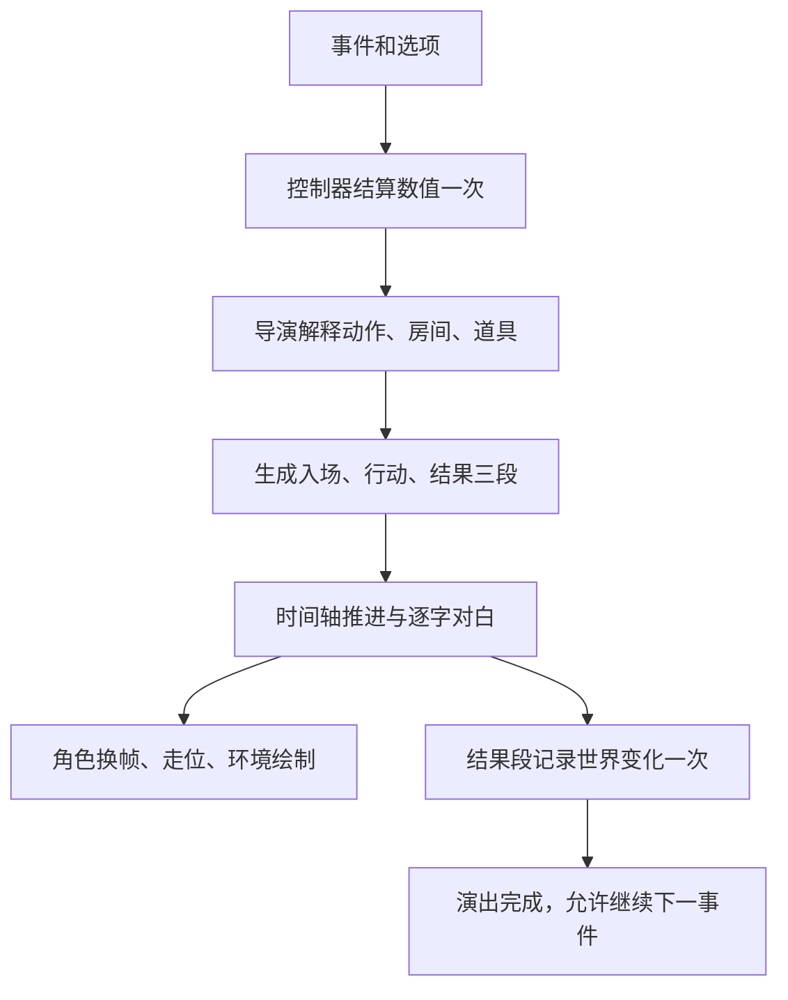

# 人生剧情像素动画：制作思路与技术实现

本文总结仓库 `00ce6e8` 中已经实现的制作方法，供后续继续生成素材、编排剧情和排查问题。对应效果与参考来源见 [首版素材说明](pixel-cast-v2.md)，完整生成提示词见 [prompts.json](../assets/portraits_v2/prompts.json)。本文记录现有实现，并将后续改进单独列出。

## 1. 核心思路：让选择产生可以看见的行为和后果

先确定“玩家选择了什么、角色应该做什么、环境留下什么变化”，再制作人物和场景。提高画面细度不仅是增加像素数量，还包括动作与文本是否一致、同一人物能否被认出、前后镜头是否连贯。

一个选项的基本演出分为三段：

1. **入场**：说明当前事件，角色走向目标位置。
2. **行动**：根据实际选项执行动作，例如抓取、交谈、休息或签约。
3. **结果**：呈现该选项自己的结果文字，并记录本局世界变化。

接受与拒绝、购买与等待等相反选择，需要分别解释，不能仅按事件标题播放同一个动作。当前采用规则与专属事件映射组合；重要剧情仍需人工设计。



图中是选项后的房间演出流程。指定事件还有一条选项前的对白过场路径，见第 4 节。

## 2. 素材生成：先制定约束，再生成图集

本次使用内置 image_gen 生成原创 PNG。参考照片用于确定青年成年主角的黑发、眼镜、灰帽黑外套，以及宿舍的铁床、柜子、书桌等特征；原始照片没有提交到仓库。

### 生成规格

| 素材 | 组织方法 | 已交付内容 |
| --- | --- | --- |
| 主角 | 六行四列；每行一个年龄阶段 | 幼年、学龄、少年、青年成年、中年、老年 |
| 婴儿 | 单行四列 | 静止、两种爬行姿态、抬手 |
| NPC | 六行四列；每行一个角色 | 母亲、同学、老师、上司、伴侣、年长邻居 |
| 基础环境 | 三列两行，每格 512×512 | 家中、教室、办公室、公园、医院、纪念园 |
| 卧室 | 单独的横向背景 | 参考照片背景特征的宿舍式卧室 |

共七个人生阶段、六类 NPC、52 个角色姿态、七处背景。角色图保留透明通道，环境图保留完整画面。

提示词需要同时约束：角色身份、每行与每列含义、相同服装与比例、脚底基线、留白、透明背景、轮廓和色板、禁止文字与网格线。背景则明确摄像机角度、道具所在区域、留给走位的空地，避免先画满场景再无处放角色。

生成结果不是严格的手工像素资产：网格位置可能偏移，存在细碎边缘和少量低透明度像素；同一角色的姿态也可能改变朝向或体积。因此需要检查图像，而不能仅凭提示词认定素材可用。模型生成具有不确定性，保存提示词可以复述意图，但不能保证重新生成相同图像；仓库里的 PNG 才是当前实现的确定输入。

## 3. 图集索引与 Godot 绘制

相关文件：

- [tools/index_pixel_atlas.py](../tools/index_pixel_atlas.py)：读取 PNG 并输出区域索引。
- [regions.json](../assets/portraits_v2/regions.json)：保存各角色、各帧的 `[x, y, width, height]`。
- [scripts/pixel_cast.gd](../scripts/pixel_cast.gd)：加载、缓存、换帧和绘制。

索引工具依赖 Python 与 Pillow。在每个候选格内，使用 **alpha ≥ 128** 的像素计算可见包围盒；只生成 JSON，不修改原图。现有主角与 NPC 图集的行边界经过人工校准，代码中的行坐标并非通用规格。替换图集后必须重新检查行边界和列数，不能直接套用旧索引。

Godot 使用 `AtlasTexture` 引用原 PNG 的局部区域，设置 `filter_clip`，并在绘制控件上使用最近邻过滤。角色以脚底为锚点：

```text
scale = 显示高度 / 帧图高度
显示尺寸 = 帧图尺寸 × scale
左上角 = round(脚底位置 - (显示宽度 / 2, 显示高度))
```

统一脚底锚点和整数坐标可以减少换帧时的跳动；各帧仍分别按高度缩放，因此不能保证体积完全一致。更严格的做法是后续人工统一画布、身体尺寸与每帧原点。最近邻过滤能避免缩放插值造成的模糊，但不能自动消除生成图中已有的柔边。

头像直接取角色帧上部约 46%，复用同一外形；当前只提供基础头像与说话姿态，不等于已经完成多表情系统。旧 `SpriteKit.compose()` 仍使用原来的分件头部，避免把新头像错误地当成整画布头部层叠加。

纹理与图集区域使用缓存持有引用。实际渲染曾发现卧室背景为白块，补充独立背景的缓存后恢复正常；因此新背景也必须走同样的缓存路径，并检查实际截图。

## 4. 两条现有播放路径

| 路径 | 负责内容 | 关键脚本 |
| --- | --- | --- |
| 选项前对白过场 | 指定事件的对白、逐字、说话人、锁定选项与确认 | `cutscene_stage.gd`、`sprite_kit.gd`、`audio_fx.gd` |
| 选项后房间演出 | 选择对应的动作、三段时间轴、结果与世界变化 | `story_director.gd`、`story_stage.gd`、`story_room.gd` |

两条路径共用新的角色与背景资源，但没有合并成单一播放器。前者已经接入主角入场步态与说话姿态，逻辑背景空间为 160×120；后者以 320×192 组织房间坐标，再缩放到 UI 动画区。

选项前对白过场使用 GitHub 最新提交的 [`pixel_cast.gd`](../scripts/pixel_cast.gd) 图集（7 个阶段 + 6 个 NPC，每人 4 帧）：剧情的 beat 字段 `action` / `target` / `face` 直接驱动走路、说话抬手与静止；`wave` / `raise` 复用抬手帧，`sit` 退回静止；`cast[].from` / `walk_time` 驱动入场走位。旧的 [`data/frames.json`](../data/frames.json) 10 表情素材保留为后续专用动作的储备，当前过场不再走这条路径。

当前角色动画由时钟计算帧号，使用 CanvasItem 绘制，不依赖 `AnimatedSprite2D` 或 `AnimationPlayer` 才能播放：

```text
行走：sequence = [0, 1, 0, 2]
      frame = sequence[int(clock × 7) % 4]
说话：frame = 3 或 0，按 int(clock × 4) 的奇偶切换
静止：frame = 0
```

对白过场的 4 帧映射（`pixel_cast.gd`）：

```text
走路：sequence = [0, 1, 0, 2]
说话 / wave / raise：第 3 帧
静止 / sit：第 0 帧
```

四帧复用能快速覆盖基础动作，但不足以表达全部剧情。当前休息使用角色图旋转后放到床上，没有专门的躺下过渡；也尚无完整四方向行走、拥抱或坐下帧。不要把这些基础演出描述为全部剧情的定制动画。

## 5. 剧情连贯与环境变化

`story_director.gd` 优先解释选项文本，并结合事件语境、特定事件 ID 和兜底动作，得到 `room / action / prop / beats / target` 等信息。`scene_id` 由事件 ID 和选项文字组成，结果段使用该选择的结果文本。

`story_room.gd` 在同一房间内插值角色位置，再绘制人物、道具和结果表现，减少无意义的跳切。新背景覆盖家中、教室、办公室、医院、公园和卧室等显示路径；其余专用房间保留既有绘制方式。纪念园已制作并在预览页展示，没有强行修改剧情来使用它。

`story_world` 保存位置、到访、作物、朋友、伴侣、孩子、住房、职业和记忆等本局状态。结果段通过 `committed` 守卫调用 `remember()` 一次；房间可根据这些状态显示孩子或生活变化。当前只是部分状态的视觉映射，并非所有累计数值都已有完整环境演变；该状态也尚未实现退出游戏后的完整持久化。

编排时必须对照画面修改文字。例如画面只有站立交谈，示例便使用“停下脚步谈起烦恼”，不能写成“坐下来”却没有坐下动作。重要剧情应进一步约定动作目标、持续时间、道具归属、遮挡和镜头，再补对应素材。

## 6. 防止点击后卡住与重复结算

数值和演出分开推进：主界面先通过 `gc.choose()` 结算数值，再把选项与变化量交给演出。点击重复保护、演出中的继续按钮禁用，以及结果段的世界状态守卫，分别防止重复选择、提前跳事件和重复记录。

房间演出每段时长为：

```text
max(1.8, 正文字符数 / 28 + 0.9) 秒
```

播放器累计 `elapsed`，计算当前段、段内时间和进度；逐字显示按约 28 字/秒推进。手动推进分两步：文字未显示完时先补全文字，已经显示完时才跳到下一段。自动播放和手动推进使用同一套时间轴更新，避免出现文字已结束但完成信号未触发的状态。

演出结束只发送一次完成信号，再允许进入下一事件。按钮需要固定在可见区域；不能仅在代码里启用按钮，还要检查它在小窗口和滚动后的实际位置。

## 7. 验证与复现

在项目根目录，使用可用的 Godot 4 可执行文件。以下命令中的 `godot` 需替换为本机路径或已配置的命令名：

```text
godot --headless --editor --path . --import
godot --headless --path . --script res://test/pixel_assets_smoke.gd
godot --headless --path . --script res://test/animation_link_smoke.gd
godot --headless --path . --script res://test/cutscene_smoke.gd
godot --headless --path . --script res://test/room_sequence_smoke.gd
godot --headless --path . --script res://test/story_smoke.gd
godot --headless --path . --script res://test/ui_progress_smoke.gd
```

现有验证覆盖角色帧区域有效、背景定位、两条示例选择能完成、522 个选择的三段演出规则、重复选择保护和真实鼠标点击推进。它们验证结构与流程，不能代替逐场检查动画语义。

打开 [PixelCastGallery.tscn](../scenes/PixelCastGallery.tscn)，按 F6 可查看角色、NPC、环境和两条示例剧情。非 headless 运行 `pixel_assets_smoke.gd` 会输出五张预览截图；需要检查透明边缘、换帧跳动、道具位置、人物遮挡、对白与动作是否一致，以及窄屏按钮是否可点击。

实现提交时上述回归通过；`cutscene_smoke` 退出时仍出现音频对象清理警告，尚未在本次素材工作中解决，不能将其记作零警告测试。

## 8. 下一阶段如何提高细度

先选择一段具体剧情，补齐入场、交互、反应、结果和离场，再扩展到其他剧情。按以下顺序推进更容易验证：

1. 为场景写动作清单，标明角色、目标、道具和环境前后状态。
2. 补四方向与专用姿态，统一画布、脚底基线、色板和物体比例。
3. 给重要选项写专属演出，逐步减少关键词兜底的误判。
4. 加入停顿、转身、视线、音效和镜头节拍，并处理前景遮挡。
5. 将本局环境记忆接入存档，检查加载后能否重建同一场景。
6. 保留自动回归与真实截图，对每条重要选择人工验收。

目标是让玩家看懂“这个选择如何改变人物与生活”。现有素材建立了制作基础；要达到《传说之下》那样完整的剧情演出质量，还需要逐场编排、专用美术和持续人工打磨。
