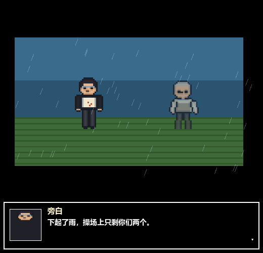
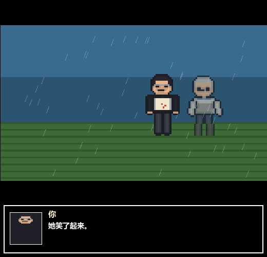

# 演出跟着台词走：文本 → 动作 / 表情 / 镜头 / 天气

> 动画分支（`animation`）。目标：让「画面」和「文字」说同一件事，而不是各演各的。
> 规则：不要求剧情数据补字段；已有的 `story_cutscenes.json`（只有 speaker / face / expr / text）也能直接受益。

## 一句台词会发生什么

以「他跑了出去。」为例：

| 层 | 之前 | 现在 |
| --- | --- | --- |
| 动作 | 站着不动，只有呼吸浮点 | 播 `walk` 逐帧，并且**真的往画面外走**（1.4 秒后没喊停才回 idle） |
| 表情 | 只有数据里写的 `expr` | 没写就从句子里读：「疼」→ hurt、「怕」→ scared、「笑」→ happy…… |
| 镜头 | 固定 | 往说话的人身上推；情绪句 +0.12，旁白 -0.06，缓动过去 |
| 天气 | 无 | 句子里有「雨/雪/风/夜」就下；出现「雨停/放晴/停了」就收 |
| 节拍 | 每字 0.045s 一个速度 | 标点留气口；有动作时**先起手 0.22s，再开口** |
| 注意力 | 所有角色一样亮 | 不是这一拍说话的人压暗到 72% |



## 优先级

1. beat 里**显式写**的 `expr` / `action` / `camera`（数据说了算）
2. 从 `text` 推断（`beat_director.gd` 的规则表）
3. 默认：`idle` + `normal`

所以剧情路线以后想精确控制，只要给 beat 加字段即可，旧数据不用动。

## 规则表

**表情**（越具体越优先，先命中先返回）：

| 表情 | 关键词 |
| --- | --- |
| hurt | 疼 痛 伤 病 血 累 喘 咬牙 |
| scared | 怕 恐 颤 抖 危险 黑暗 不敢 |
| angry | 怒 骂 吼 吵 气死 恨 滚 |
| surprise | 惊 吓 突然 愣 呆 竟然 猛地 |
| sad | 哭 难过 伤心 眼泪 舍不得 失落 沉默 |
| shy | 害羞 脸红 不好意思 低头 |
| determined | 一定 决定 发誓 坚持 咬 握紧 |
| happy | 笑 开心 高兴 喜欢 暖 甜 乐 |

**动作**（长词优先，避免「走廊」被当成「走」）：

| 动作 | 关键词 |
| --- | --- |
| sit | 坐下 坐着 躺下 躺在 蹲下 趴在 瘫 |
| wave | 挥手 招手 摆了摆手 挥了挥 告别 |
| raise | 举起 抬起 伸手 够到 接过 递给 抓住 |
| walk | 走了 走进 走出 跑 奔 追上 逃 冲向 |

**天气**：雨 → rain；雪 → snow；风 → wind；夜/天黑 → night；雨停/放晴/停了 → clear。



## 动作细节

- **走路是真位移**：`offset_x` 每帧 +26 场景像素，朝远离画面中心的方向，走到 ±52 停住。
- **表情停帧**：idle 只有第 0 帧烘焙了表情，有情绪时停在那一帧，不会两帧之间把脸跳回无表情。
- **眨眼**：idle 且无情绪时，每 4.2 秒（按角色错开）闪一下 `blink` 帧。
- **动作延续**：这一拍没说停，上一个动作再演 1.4 秒；文本出现 sit/walk 等新动作立刻切换。

## 代码位置

| 文件 | 职责 |
| --- | --- |
| `scripts/beat_director.gd` | 纯逻辑：关键词 → 表情/动作/天气，镜头建议，逐字节拍 |
| `scripts/sprite_kit.gd` | `frame(key, action, idx, expr, is_npc)`：读 `data/frames.json` 取帧 |
| `scripts/cutscene_stage.gd` | 演员状态机（动作/表情/位移）、camera 缓动、天气层、压暗非说话者 |
| `test/text_sync_smoke.gd` | 规则表、显式优先、镜头、帧资源、动作起手 |

## 验证

```bash
godot --headless --path . --script res://test/text_sync_smoke.gd
godot --headless --path . --script res://test/cutscene_smoke.gd
```

截图：

```bash
godot --path . --script res://tools/capture_anim.gd -- <输出目录>
```

## 还没做的

- NPC 的表情头只有 base（`npc_*_idle_0_normal`），台词说「妈妈难过」时 NPC 的脸不会变——需要补 NPC 表情帧。
- 天气只有雨/雪/风/夜四种，且是整段过场级的，不随镜头局部变化。
- 动作只有 walk/wave/raise/sit 四个，没有「转身」「坐下起身」等过渡帧。
