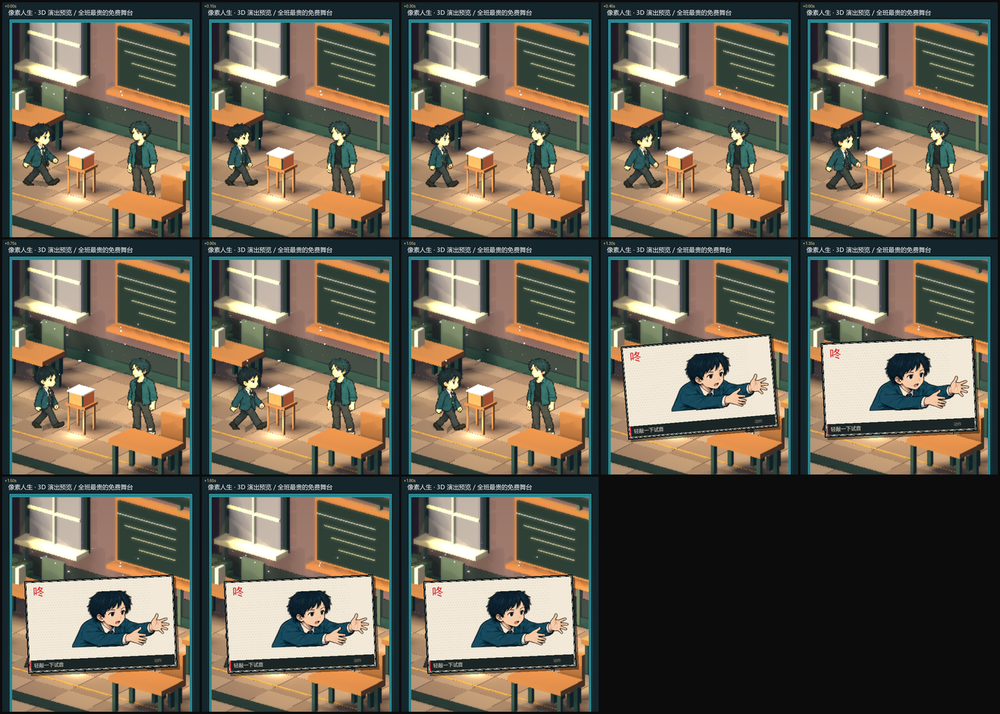

# 动作漫画弹窗（cut-in）

> 动作触发的那一刻，不靠 3D 动画硬演，而是弹一张**漫画分格**：
> 斜切墨框 + 网点 + 动作立绘 + 竖排拟声词 + 一行标题。
> 图全部复用 `comic_actions` / `comic_expressions`，**不新增美术资源**。



## 为什么这样做

3D 舞台做「敲鼓、递东西、写字、翻书」这类动作，有两种成本：

| 做法 | 成本 |
| --- | --- |
| 每个动作做一段 3D 动画 | 建模 + 骨骼 + 关键帧，动作越多越贵 |
| 每个动作画一张漫画分格 | 一张图 + 一次弹窗，**动作数量可以随便加** |

漫画分格还有叙事上的好处：它是「作者跳出来强调这一下」的语法。
读者会把它读成「这一格很重要」，而不是「一个角色在动」。

## 时间轴

| 时间 | 发生什么 |
| --- | --- |
| 0.00–0.24s | 弹出：0.72 → 1.06 倍，带回弹，旋转 −8° → −2.6° |
| 0.24–0.42s | 落定：1.06 → 1.00 倍 |
| 0.42–1.45s | 停留，读标题和拟声词 |
| 1.45–1.80s | 收走：淡出 + 轻微放大 |

## 画面构成

- **纸边 + 双层墨框**：外层 3px 墨线，内层 1.5px，左上有硬投影；
- **网点**：7px 斜向错排的小点，给「印刷」的底；
- **动作立绘**：优先 `comic_actions` 的动作帧（reach/read/phone/draw/wave/drum…），
  没有就退回表情立绘；
- **竖排拟声词**：按动作取（咚/唰/哗/嗡/嗨/！），红色；
- **底部标题条**：左边一条红杠 + 事件 label + 右侧「动作」小标。

## 触发条件

- 交互进行到 **1.25s**（手接触物件）时自动弹；
- 一次交互只弹一次（`cutin_armed`），重播交互会重置；
- 可在数据里用 `pixel_cutin` 覆盖：`{key, action, expression, title, sfx}`。

## 代码

| 文件 | 作用 |
| --- | --- |
| `scripts/pixel_cutin.gd` | 纯绘制 + 时间轴 + 拟声词表 |
| `scripts/pixel_stage_view.gd` | `cutin_time` 状态、接触点触发、`draw_on` 里叠加 |

## 验证

```bash
godot --headless --path . --script res://test/pixel_motion_smoke.gd
# PASS: ... cut-in timeline
```

连拍（每 0.15s 一帧，能同时看到走位与弹窗）：

```bash
godot --path . --script res://tools/capture_motion.gd -- <输出目录>
```

## 下一步可以做的

- 弹窗分「轻/重」两档：普通动作小弹窗（占画面 1/3），关键动作大弹窗（现在这种）。
- 弹窗出现时把 3D 舞台轻度降饱和/压暗，视线会更聚焦在分格上。
- 给弹窗加「贴纸感」的旋转随机值，避免每次都同一个角度。
