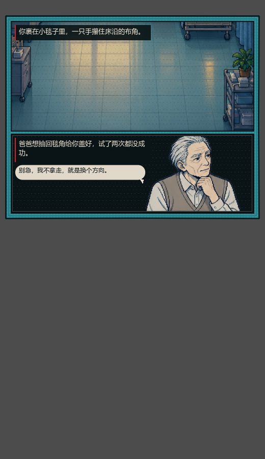
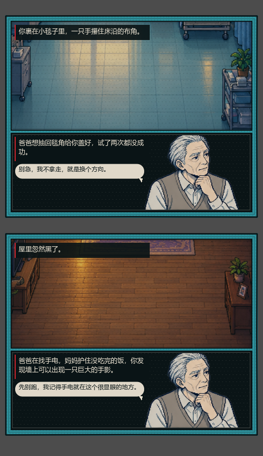

# 漫画插页：演不出来的内容交给漫画

> 有些剧情是心理、回忆、抽象的（"你还没学会害怕"、"屋里只剩钟声"），
> 让 3D 角色去演只会变成站着不动。这类页换成一张**双格漫画**：
> 场景做建立镜头，旁白框交代事实，气泡放人物的话，立绘负责表情。
>
> 目前**只应用到前半生（0–30 岁）**。





## 什么时候换成插页

在生成漫画页时（`life_comic_pages.make`）判断，命中就替换**第一块**符合条件的格子：

1. 年龄 ≤ **30**（`FIRST_HALF_AGE`）；
2. 动作是 `idle`（没有可演的动作）；
3. 没有专属 CG、没有场景互动（这两类已有自己的表现）；
4. 格子里有旁白或气泡（有字可搬）。

后面几格保持原样（3D 舞台 / 手绘线稿），所以一页里是「漫画插页 + 正常分格」混排。

## 两格怎么排

| 格 | 内容 | 用图 |
| --- | --- | --- |
| 第 1 格 | 场景建立镜头 + 旁白（事实） | `assets/rooms/<scene>.png` |
| 第 2 格 | 黑底 + 立绘 + 旁白（补充） + 对话气泡 | `comic_city` 立绘（按角色/年龄） |

- 旁白：事件 `facts` 的第一句放第 1 格，第二句放第 2 格；
- 气泡：优先用该格已有的对白，没有就取事件的 `npc_dialogue`，并去掉「爸爸：」这类前缀；
- 框：双层墨线 + 网点 + 左侧红条，和整本漫画的语法一致。

## 不新增资源

全部复用现有图集：

- `comic_city`（立绘，7 年龄段 + 6 NPC）
- `assets/rooms`（7 个场景）
- 字体、网点、红条来自 `comic_theme`

插页本身是纯绘制（`pixel_comic_insert.gd`，约 130 行），没有新贴图、没有新动画。

## 代码

| 文件 | 改动 |
| --- | --- |
| `scripts/pixel_comic_insert.gd` | 双格排版 + 场景图 + 旁白框 + 气泡（新） |
| `scripts/life_comic_pages.gd` | `_apply_insert`：前半生筛选与数据组装 |
| `scripts/comic_panel.gd` | `comic_insert` 优先绘制，跳过原文字层 |
| `scripts/comic_page.gd` | 插页格最小高度 360 |

## 验证

```bash
godot --headless --path . --script res://test/comic_insert_smoke.gd
# PASS: comic insert only in first half, with narration and bubble
```

断言覆盖：前半生 7 个事件都产生插页、固定两格、第一格有旁白、第二格有气泡；
40 岁与 65 岁的页不得出现插页。

截图：

```bash
godot --path . --script res://tools/capture_insert.gd -- <输出目录>
```

## 还没做的

- 30 岁是写死的常量，没有按寿命/剧情阶段动态算。
- 一页只换一格；如果要「整页漫画化」，需要页面级开关。
- 第 2 格固定用立绘，没有按文本换表情/动作。
