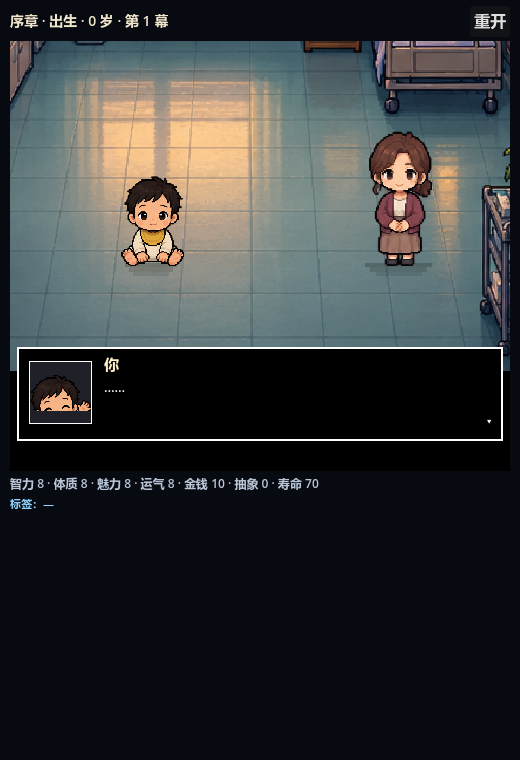

# 经典 Demo · Godot 移植

> 场景：[`scenes/DemoTrial.tscn`](../scenes/DemoTrial.tscn)
> 控制：[`scripts/demo_trial.gd`](../scripts/demo_trial.gd)
> 原始单文件 demo：[`docs/demo-trial.html`](demo-trial.html)



## 这是什么

把 `docs/demo-trial.html` 的「序章 + 人生池」试玩搬进 Godot，并接上最新的 `pixel_cast` 角色、手绘房间和场景 camera：

- **序章**：从 `story_opening.json` 的 `OP01` 开始，按 `choices[].next` / `next.when` 走分支；有专属过场的节点用 `story_cutscenes.json`，没有的自动生成一段对白。
- **人生池**：序章结束后进入随机人生，按年龄/标签/权重抽事件，选项结算效果与标签，年龄 +1～2 岁，最多 34 幕。
- **结算**：按 HTML demo 的规则算综合分与评级，显示「这辈子到这儿」和重启按钮。
- **镜头**：选中选项后切到结果镜头，camera 轻微推近，上下出现 letterbox 黑边，按效果正负闪白/闪黑，结果文字逐字打出。

## 开始方式

- 运行 `Main`，标题页点 **经典 Demo · 序章 + 人生池**；
- 或直接打开 [`scenes/DemoTrial.tscn`](../scenes/DemoTrial.tscn)，按 **F6**；
- 左上角 **重开** 可随时从头再来。

## 和 HTML demo 的区别

| | HTML demo | Godot 移植 |
| --- | --- | --- |
| 人物 | `assets/chars` 分件 + `rig.json` | 最新 `pixel_cast` 图集（7 阶段 + 6 NPC） |
| 房间 | `assets/scenes` 场景壳 + 道具层 | `assets/portraits_v2` 手绘房间 + 512×288 16:9 裁切 |
| 文本 | 下方标题/正文 + 按钮 | 对话框内逐字 + 心形光标选择（CutsceneStage） |
| 镜头 | camera push + bars + flash | 同一个 camera 变换：zoom 推近 + letterbox + flash |
| 逻辑 | 内嵌 JS | `GameController` / `GameState` / `DataLoader` |

剧情数据仍以 SL 仓库里的 `story_opening.json`、`game_data.json`、`story_cutscenes.json` 为准，不在 Godot 里另存一份。

## 实现要点

- 序章节点和人生事件统一转成 `CutsceneStage` 的一场戏：
  - 有 `cutscene_for(id)` 就用专属过场；
  - 没有就按年龄选一个房间、一个 NPC，生成「旁白 + 事件正文」的一镜。
- 选择结算走 `GameController.choose()`，自动应用 effects / tags / relations / memory；分支 next 走 `_resolve_next()`。
- 结果镜头把当前过场的 cast 复制一份、去掉 `from`（避免重新入场），camera zoom +0.06，套上 letterbox 和 flash。
- 年龄推进：`+1` 或 35% 概率 `+2`，然后 `_next_phase(0)` 只跑抽象度回归/标签效果，不额外涨年龄。
- 人生池按 `seen` 去重；抽空时清空 `seen` 再抽，避免卡死。

## 验证

```bash
godot --headless --path . --script res://test/demo_trial_smoke.gd
```

`demo_trial_smoke` 会实际实例化 `DemoTrial`，从 `OP01` 开始，模拟选择走完序章、进入人生池、一直玩到结算，检查总结出现「综合分」。

当前 12 个 headless 回归全部通过。
