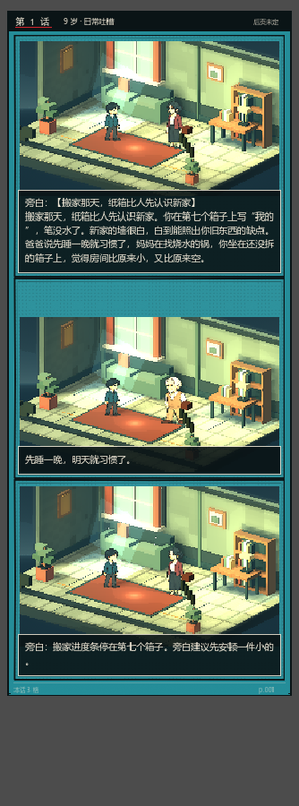
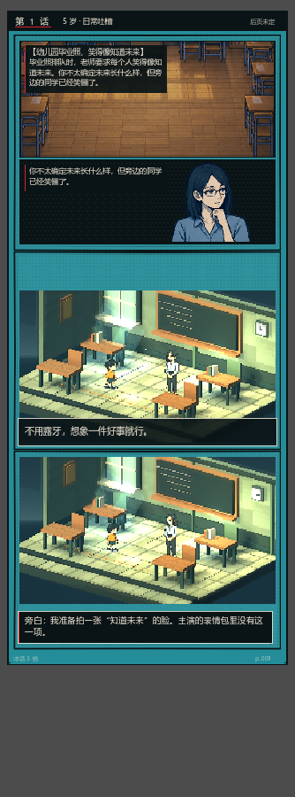

# 对话框叙事：剧情都在框里说

> 按你的要求：**不切成文本页，保持上一版的分格 + 对话框**，
> 长剧情直接放进对话框里说完。LC29 搬家、LC30 父亲的手机是第一批。





## 一、保持什么

- 每一格仍然是 **3D 舞台 / 立绘 + 墨框**；
- 旁白、对白仍然走右下或底部的框；
- 页面高度、翻页节奏和普通页一致，不额外切换形态。

## 二、对话框怎么画

`comic_panel._draw_dialogue_box()`：

| 项 | 值 |
| --- | --- |
| 位置 | 贴住格子下沿，左右各留 8px |
| 底 | 墨色 90% 不透明 + 1.5px 奶油描边 |
| 字 | 宽格 16px / 窄格 14px，奶油色 |
| 行距 | 字号 + 8 |
| 上限 | 最多占格子高度 62%，超出按行截断（页面会先估高，正常不会截） |
| 说话人 | 若对白是「名字：台词」，名字用红色小字放在框内第一行 |

## 二·五、说话人半身像（参考 Undertale）

人物说话时，把**半身像放在对话框左侧**，文字在右侧：

- 立绘来源：`assets/comic_city/lead.png` / `npc.png`（就是图一那版，7 个年龄段 × 2 姿势）；
- 说话人 → 立绘 key 的映射在 `comic_panel.speaker_key()`：
  妈妈→`npc_parent`、爸爸→`npc_mate`、老师/班主任→`npc_teacher`、同桌/同学/朋友→`npc_friend`、
  你/我→当前年龄的 lead；映射不到就用格子的 `support`，再不行用 `ink`；
- 半身像高度取格子高度的 46%（96–190px），文字宽度相应让出左侧；
- 对话框最大占 72% 高度，对白格最小高度 320px，保证脸和字都放得下。

旁白（无说话人）不加立绘，保持纯文字框。

## 三、容量

- 页面估高时对 `box == "dialogue"` 的格子按 16px 字宽重算行数（每行 24px），
  字越多格子越高，避免文字被裁；
- 普通格子仍按原来的 15px / 21px 估算。

## 四、长文本事件

| id | 年龄 | 内容 | 文本量 |
| --- | --- | --- | --- |
| LC29 | 9–13 | 搬家那天，纸箱比人先认识新家 | 开场约 120 字 |
| LC30 | 14–17 | 父亲的第一部手机，只会接不会打 | 开场约 110 字 |

事件上标 `text_only: true` 只表示「长文本、整页对话框」，**不再切换 presentation**；
`_apply_insert` 会跳过这些页，避免又叠一层漫画插页。

## 五、验证

```bash
python tools/check_story.py
godot --headless --path . --script res://test/text_mode_smoke.gd
# PASS: LC29/LC30 keep dialogue boxes and carry enough text
```

断言：两页每一格都是 `box == "dialogue"`、都没有被切成 `presentation == "text"`、
正文合计 ≥120 字。

另有一条立绘回归：

```bash
godot --headless --path . --script res://test/dialogue_portrait_smoke.gd
# PASS: speaker mapping and dialogue panels present
```

## 六、备注

- 之前的纯文本页渲染（`_draw_text_page`）代码还在，但当前没有事件使用；
  以后要「整页文字」可以再把 `presentation: "text"` 打开。
- 对话框目前会盖住角色下半身；如果要做「角色不被挡」，需要按角色高度动态上移。
