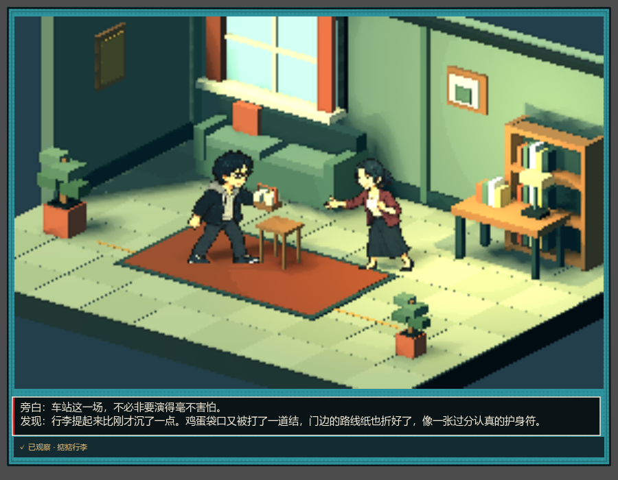

# 3D 场景 + 2D 像素人物

2026-10-24 根据用户补充图片纠正演出方向：真实 3D 房间、家具和灯光中，放置平面的 2D 像素人物。主游戏与 PixelStageLab 均改用这条路径。此前体素人脚本只作为历史实现保留，不再被主舞台加载。

## 实现

- `pixel_billboard_actor.gd` 以 `Sprite3D` 展示仓库现有全身人物图集，主角和 NPC 共用构图与比例规则；奶蛙保留自己的 2D 像素素材。
- 待机、说话、伸手、挥手选择对应全身姿势；主角走路使用四帧步态。角色在世界中移动，图像平面随相机朝向更新，避免侧向镜头把人物看成一条线。
- 最近邻采样保持清晰像素。透明裁切去掉矩形背景；人物参与场景光照、深度测试和投影。人物不是覆盖在漫画最上面的 UI，因此会被场景前景遮挡。
- 脚底固定在角色的 3D 位置。贴图中心沿相机上方向移动半个人物高度；持物锚点依据当前姿态、左右朝向和镜头同步计算，继续连接观察、接物与特殊镜头。
- 五种立体布景、31 个事件观察、16 段实时镜头和书签格式沿用上一版。

参考图片与《风来之国》《八方旅人》用于确定二维人物、立体空间和色彩层次的方向。本次复用项目已有美术并更换角色渲染方式；环境仍是现有五种布景，尚未达到参考图的建筑装饰密度，也未制作完整八方向角色动画。

## 查看

首次导入、正确项目目录及技术接入链路见 [Godot 导入与技术说明](godot-hd2d-import.md)。

Godot 的 `scenes/PixelStageLab.tscn` 按 F6 可预览；F5 后从首页进入「折痕与歪楼 · 新剧情漫画人生」。已有书签也使用新的二维人物，不需要重新开始。

验证：`pixel_stage_smoke` 检查角色确实是 Sprite3D、没有体素身体、与相机平行、手部接物位置及离屏释放；`life_comic_ui_smoke` 检查实际选择、窄屏与恢复；`pixel_reader_smoke` 检查互动存档、镜头重播和窗口缩放。
