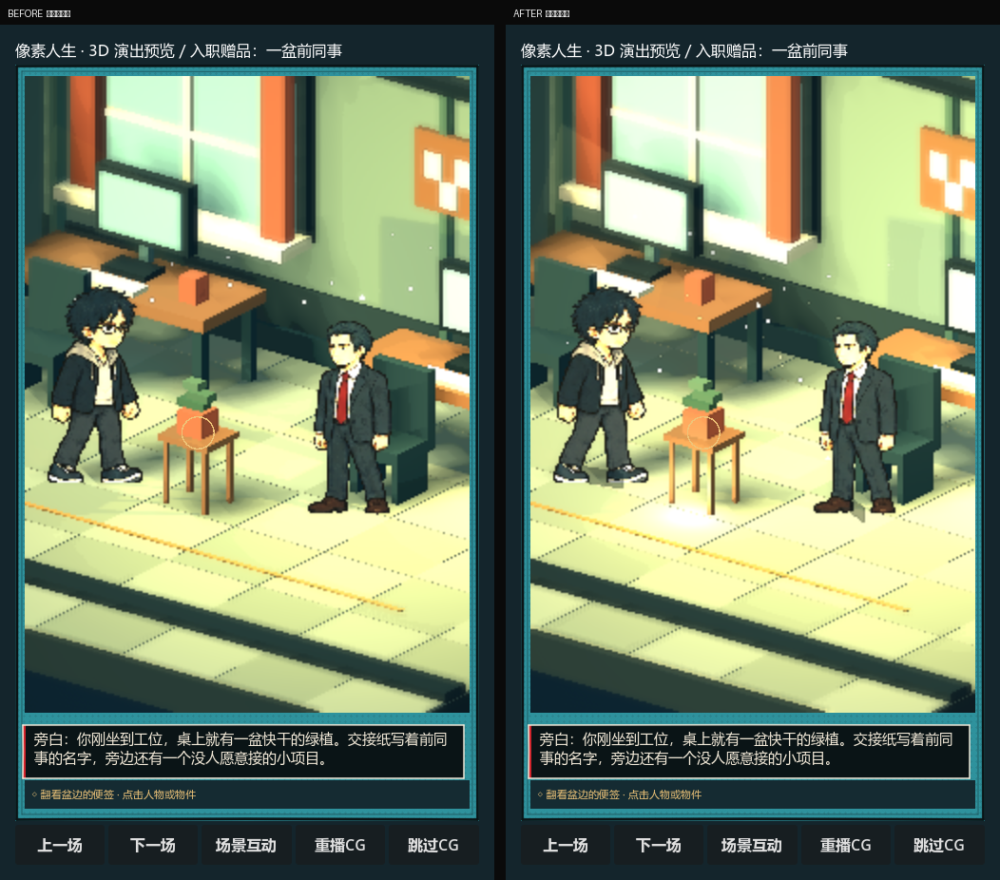
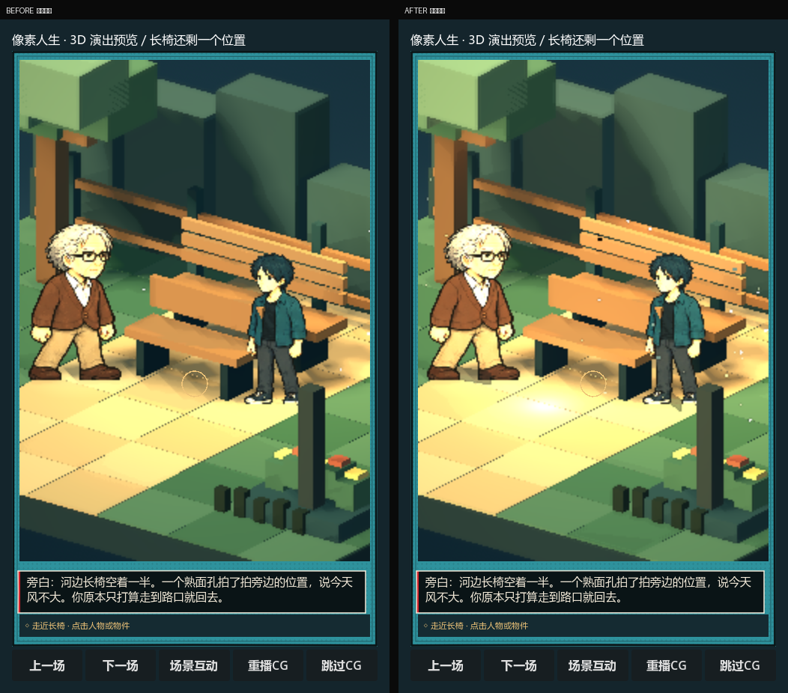

# HD-2D 光影叠加与粒子

> 基于 `438ad7d`（移轴景深 + 光池 + 前景层）再往前一步：**多光源分层 + 体积感 + 空气里的粒子 + 接地影**。
> 全部用程序化几何与 `CPUParticles3D`，不依赖新贴图，GL Compatibility 也能跑。



## 这次加了什么

### 1. 光的分层（从 4 盏到 7 盏 + 光池）

| 层 | 类型 | 作用 |
| --- | --- | --- |
| 主光 | DirectionalLight3D（暖） | 定基调，投影 |
| 冷补光 | DirectionalLight3D（青） | 压住阴面，不出硬影 |
| 轮廓光 | DirectionalLight3D（暖，强度 0.34 / 夜 0.42） | 把人物从背景里剥出来 |
| 实用光 1 | OmniLight3D（暖，带阴影） | 灯下主光源 |
| **实用光 2** | OmniLight3D（办公室=屏幕冷光 / 家=床头暖光 / 公园=第二盏路灯） | 第二层光斑，画面不再是单一光源 |
| **地面反弹** | OmniLight3D（贴近地面，弱） | 抬起裙板、裤腿、桌底，避免下半身死黑 |
| 呼吸 | `pixel_light_breath.gd` | 两盏实用光在 ±7%/±10% 之间缓慢起伏，不是死亮 |
| 光池 | 加色混合的圆形贴片 | 每盏实用光在地面留一块落点，第二盏也有 |

### 2. 体积感

- 窗口光柱加粗到两束：主束 + 一束更淡、角度不同的副束，叠在一起才有「空气」。
- 光柱强度：白天 0.10 / 夜里 0.15，副束 0.05 / 0.075。

### 3. 粒子（空气里的东西）

| 场景 | 粒子 |
| --- | --- |
| 室内（默认） | 灯下浮尘 34 + 窗口细尘 24（暖色、加色混合、缓慢漂移） |
| 公园 · 白天 | 飘絮 44（向上）+ 落叶 9（下落、可旋转） |
| 公园 · 夜里 | 飘絮 + **萤火 18**（极小、加色） |
| 全部 | 粒子都带 `preprocess`，进场时就已经飘满，不会从零开始 |

### 4. 接地影

每个角色脚下加一片压暗的方片（`FeetContactShadow`），随身高缩放、跟着角色移动。方向光的投影解决「形体」，接地影解决「站得住」。



## 数值变化（同场景、同 seed）

| 场景 | 平均亮度 | 对比度 |
| --- | --- | --- |
| 办公室 | 116.1 → **123.3** | 80.1 → **84.3** |
| 夜间公园 | 88.4 → **94.0** | 64.2 → **67.1** |

不是「整体调亮」，而是把亮度加到该亮的地方（灯下、人物边缘、地面反弹），暗部仍然压住。

## 代码位置

| 文件 | 职责 |
| --- | --- |
| `scripts/pixel_fx_3d.gd` | 浮尘 / 飘絮 / 落叶 / 萤火 / 接地影 / 灯光呼吸（新） |
| `scripts/pixel_light_breath.gd` | 灯光能量呼吸（新） |
| `scripts/pixel_environment_3d.gd` | 第二盏实用光、地面反弹光、第二道光柱、场景粒子 |
| `scripts/pixel_billboard_actor.gd` | 角色接地影 |

## 复现

```bash
godot --path . --script res://tools/capture_art_cmp.gd -- final "D:/gamelife/_render_cmp"
```

`final_03_indoor.png` / `final_02_lc24.png` 就是本文的 after 图；before 用同一脚本在 `438ad7d` 上跑。

## 还能往上加（未做）

- 屏幕/灯具的自发光面片与对应的局部光（现在只有光，没有「发光体」）。
- 雨/雪天气粒子（需要剧情数据里有天气，否则会穿帮）。
- 角色轮廓的菲涅尔描边（现在是靠轮廓光，边缘仍偏软）。
- Forward+ 下开 SSAO 做接触阴影，比贴片更准。
