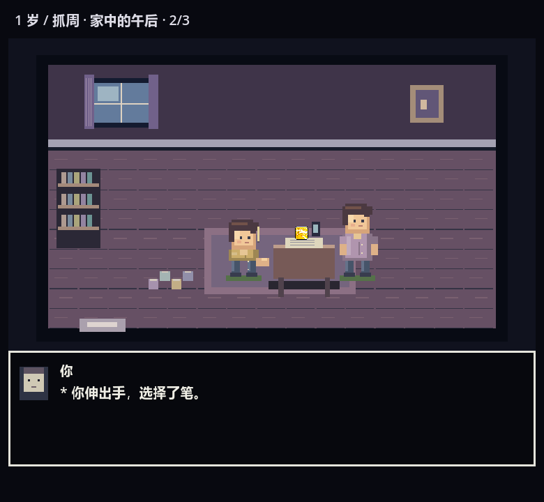
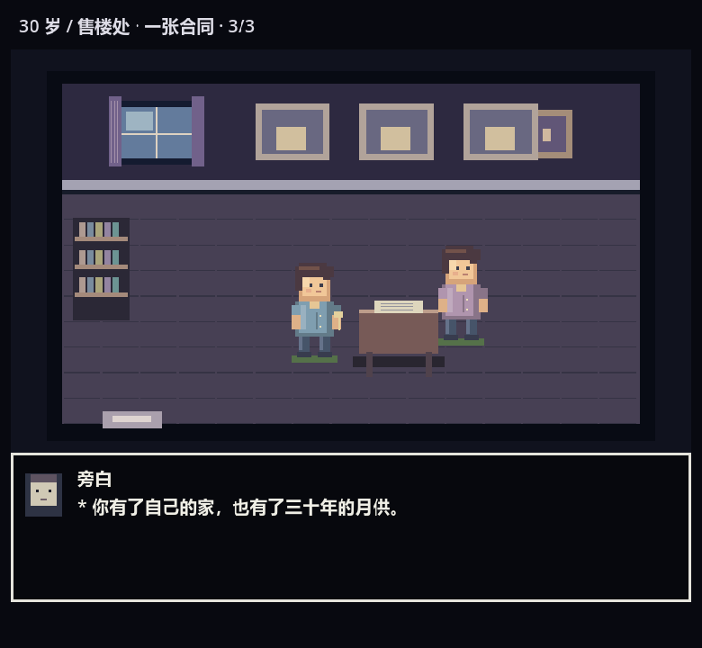
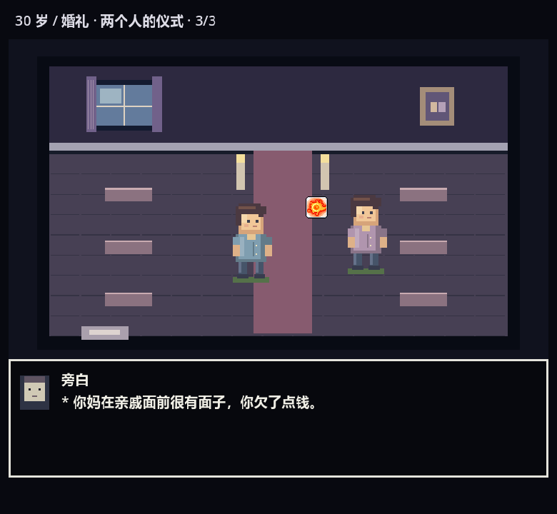

# 独立像素场景与连贯分镜

Godot 4 打开 project.godot，运行 Main。点击选项后，像素剧场切入一个独立的房间或室外布景，在同一空间内完成入场、行动、结果三段演出。参照《传说之下》的深色画面、简洁像素人物、白框对白和逐字叙事形式；角色与布景为本工程原创程序绘制，道具沿用 SL 既有资源。

## 场景与剧情

布景包含抓周房间、教室、办公室、医院、售楼处、婚礼、卧室、客厅、小剧场、公园、河岸、菜园、操场、车站。布景按主题复用，当前并非 432 套独立手绘美术；每个选项有独立标识和取自实际事件的三段剧情文本，并通过动作、道具和走位表现分支。

- 抓周三个选项对应笔、钞票、手机；角色从门口走到桌边，再拿起所选物品，结果镜头继续持有该物品。
- 买房的接受与等待都在售楼处：接受选项签合同、拿钥匙；等待选项停下并向出口离开。
- 婚礼、出生、治疗、上课、工作、休息、钓鱼等切换相应环境。年龄改变人物形象，家庭相框与住宅摆设继承本局经历。
- 第一段使用事件正文，第二段演出所选行动，第三段使用原始结果文本；抽象线使用界面实际显示的替代正文。

## 播放与交互

每段根据文字长度分配时间，逐字显示后留出阅读停顿。默认自动播放；底部“下一段 / 补全文字”按钮第一次补全文字，文字完整时再次点击进入下一段。可通过 Tab 选择按钮、空格确认。剧情结束才允许“继续人生”，避免一次点击重复推进年龄。继续按钮始终固定在窗口底部。

当前已覆盖 432 个选项的分镜编排和完整运行。细节较少的事件共用主题布景与基础动作，后续可逐事件增加专属表演。世界记录继续保存在本局 GameState.story_world；新人生重置，尚不提供中途退出后恢复。

## 实现与验证

- scripts/story_director.gd：地点、行为、场景、三段台词及世界记录。
- scripts/story_room.gd：独立布景、放大人物、道具操作、连续走位与对白框。
- scripts/story_stage.gd：逐字播放、分镜计时、手动推进与一次完成信号。

```
godot --headless --path . --script res://test/room_sequence_smoke.gd
godot --headless --path . --script res://test/ui_progress_smoke.gd
godot --headless --path . --script res://test/world_smoke.gd
godot --headless --path . --script res://test/story_smoke.gd
```

OpenGL 渲染与 headless 检查通过：432 个选项都具备三段分镜，结果保持原文，拿取物品、签约与等待分支、世界记录和仅完成一次的行为正确；520×900、520×640、360×640 下真实鼠标输入验证自动播放、手动分段和继续人生。




