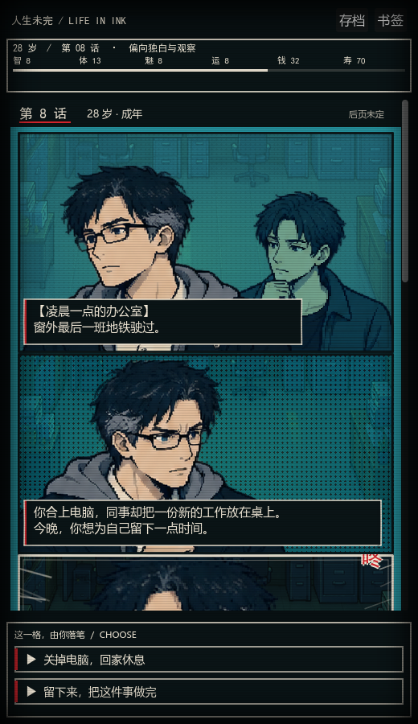
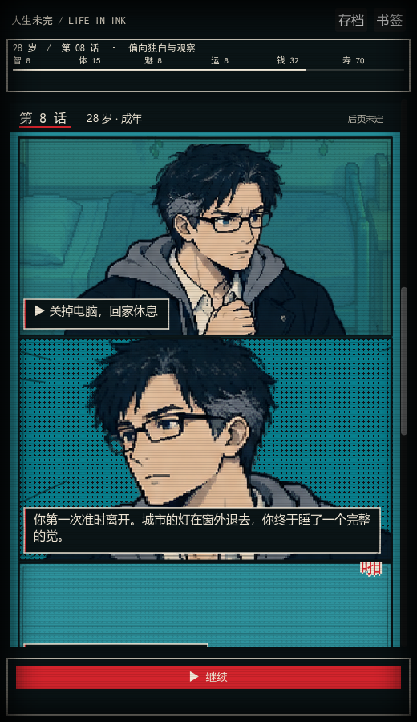
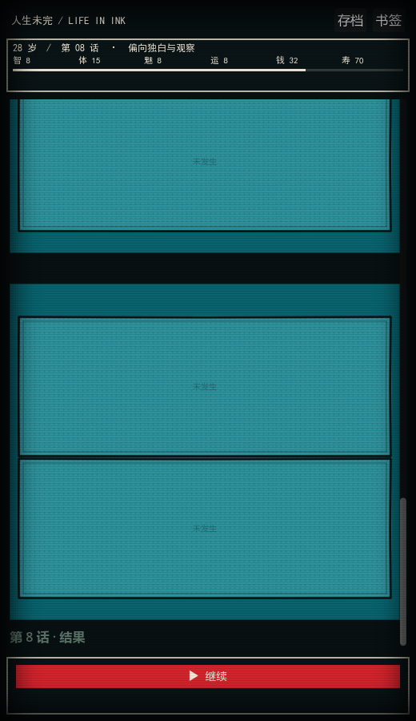
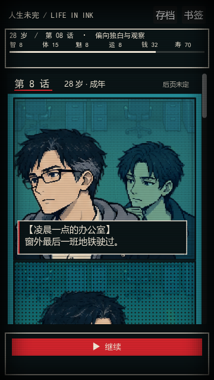

# 人生未完：纵向漫画玩法与界面

## 打开与操作

使用 Godot 打开仓库根目录的 [project.godot](../project.godot)，按 F5。主场景是 [Main.tscn](../scenes/Main.tscn)，不是历史快照 `godot_demo` 中的演示项目。

1. 开始人生、掷骰，进入漫画阅读界面。
2. 向下滚动查看分镜；进入阅读区域的空格逐渐填入人物和文字。
3. 底部选择决定这一段生活，结果会追加到下一张漫画页。
4. 点击继续进入后续年龄；已经绘制的页保留，可以向上回看。
5. 顶部「存档」保存书签，「书签」保存后返回首页。首页可以继续未完成的人生。
6. 完结后自动保存到人生书架，支持重新翻阅；重开会获得新的随机序列。

桌面可用滚轮，触屏可使用系统的滑动输入。主动滑动会停止本次自动滚动，避免阅读时被拉回。操作区固定在底部，选项过多时可单独滚动；360×640 也保留选择入口。






## 分镜与玩法规则

每局出生时固定一个分镜配置：随机种子、密度偏移 -1～1、日常带过概率等。每一话另有 0～1 格的随机波动。这些参数与随机数生成器的完整状态一起存档，**保存和读档本身不会重抽人生**。

```text
本话格数 = 年龄基准 + 体质修正 + 性格修正 + 抽象度修正
         + 本局密度偏移 + 本话随机值
最后限制为 2～6 格
```

| 因素 | 当前规则 |
| --- | --- |
| 年龄 | 0～12 岁基准 2 格；13～18 岁 3 格；19～30 岁 4 格；31 岁以后 5 格 |
| 体质 | ≤3：-2 格；≤6：-1 格；≥16：+1 格；其他不变 |
| 性格 | 选择形成的外向/行动标签最多 +2，观察/内向标签最多 -2；不是对性格好坏的评分 |
| 抽象度 | ≥61 时 +1 格 |
| 人生长度 | 使用游戏已有的寿命、健康与选项效果；寿命效果改变终章时间，健康耗尽也可提前结束 |
| 历史分镜 | 累计保留；后续健康或性格变化只影响新页，不删除已画的人生 |

性格影响叙述密度，不直接等同于寿命。结果页会显示具体属性变化与获得的标签，避免只显示一个难以理解的属性总和。页眉显示「后页未定」，不把寿命错误标作实际漫画总话数。

### 提笔带过

普通、低影响的日常事件可以随机压缩成短叙述，两段连续日常可以合成一页；下一段正常剧情出现前会先补记尚未显示的日常，保持年龄顺序。

以下情况保留玩家选择：序章与联动节点、带后继分支的事件、性格标签或关系变化、寿命变化、大幅属性变化、婚姻/买房/考试等重要事件，以及体质已经偏低的阶段。自动带过只在符合上述限制的日常事件内随机选择低影响结果，不自动替玩家确定重要人生分支。

每个游戏事件可能推进不止一年，所以界面使用「带过 N 段日常」，不会把事件数量误写成经过的年数。

## 阅读器与美术实现

- 保留 SL 的角色身份、七阶段映射、alpha 区域索引、图集缓存技术；新增独立的都市悬疑半身像图集，旧美术资源保留。
- 参考 `animation-portrait-assets` 的 `9b1d14b` / `58b8190`：人物独立区域、背景整图、保持比例；也读取了 `animation` 分支的文本与演出同步思路。
- 七阶段主角、六类 NPC 各有两种半身姿态，共 26 张。成人采用较小的眼睛、较成熟的脸部与肩颈比例，青黑阴影、米白与少量红色强调。新 PNG 和完整生成提示词放在 [assets/comic_city](../assets/comic_city/prompts.json)。
- 原创图由内置 image_gen 生成。`index_comic_city.py` 只读取 alpha 边界生成 JSON，不修改 PNG；替换图集时需要重新检查行坐标。
- 背景复用 SL 的完整房间图，以中心裁切铺满分镜，保持宽高比，再施加青色调制；不重复叠加同一套家具。
- 页面改成适合手机的纵向镜头序列，格高按镜别与文字量计算，不把多格硬塞进固定高度。最近邻过滤、不旋转人物画面，保持像素边缘。
- 空白页只作未来的视觉占位，不代表预先决定的事件或寿命。下一页到来时替换首个空白位，并在末尾补空白。
- 进入可视范围后逐格显现；重读历史时直接还原已有内容。固定状态栏显示年龄、性格倾向、属性与体质条；操作区与漫画滚动分离。

主角与 NPC 当前只有两种新姿态，并非动画分支 17 种表情的同等覆盖。剧情场景、人物和性格仍以规则映射为主，不能声称每个事件都有专用插画或完整动作。

用户提供的两条 B 站参考：

- [BV1MpQ3YEEHi](https://www.bilibili.com/video/BV1MpQ3YEEHi/)
- [BV1bMJX6jE5c](https://www.bilibili.com/video/BV1bMJX6jE5c/)

本次网页读取未成功（412/不可访问），没有声称逐帧观看视频；画面风格依据用户上传的参考截图，衔接依据用户描述的手机漫画下滑流程实现。

## 存档与生命周期

[comic_archive.gd](../scripts/comic_archive.gd) 使用版本化的 Godot Variant 二进制文件，保存 GameState、分镜参数、已画页面、当前事件、选择前/后阶段、待汇总日常、阅读位置与 RNG 的 seed/state。这样可以直接保留 Rect2 版式和 64 位随机状态，不经过 JSON 的数值转换。

写入临时文件后替换正式文件，同时保留上一份 `.bak`；读档允许回退备份，不开启对象反序列化。成就图鉴仍使用原来的独立存储。

选择效果已发生但结果页尚未形成时，暂缓自动保存，避免读档后在旧选择界面再次叠加效果。自动滚动结束后再更新阅读位置，关闭窗口时也会尝试保存稳定的书签。

- 当前书签：`user://life_comic_v1.save`
- 完结书架：`user://comic_books/<人生种子>.save`

读档不会再次调用事件抽取、生成旧页或结算选项。选择与继续都有重复触发保护。完结标记随存档保留，回看不会把完结人生恢复成可继续结算的状态；从书架打开旧人生也不会覆盖当前书签。新人生会清空旧页面、跳过缓冲和选择状态。

当前界面支持一个进行中的书签和多个完结漫画；没有提供多个未完结手动槽、云同步或漫画图片导出。

## 验证

```text
godot --headless --path . --script res://test/comic_smoke.gd
godot --headless --path . --script res://test/comic_reader_smoke.gd
godot --headless --path . --script res://test/comic_life_cycle.gd
godot --path . --script res://tools/capture_life_reader.gd
```

- 分镜规则、版式和主场景生成检查。
- 26 张新人物区域有效；真实鼠标选择；重复结算保护；存档替换和备份；原布局与随机状态读档；完结状态保持；360×640 操作区和漫画宽度。
- 两个固定种子的完整人生从童年走到结局，并检查历史页累计与重开清空。改动期间的一次完整回归同为 45 岁结局，分别留下 193 格与 183 格，说明相同终止年龄也可以形成不同漫画篇幅。
- 五张截图来自实际 Godot 渲染，捕获工具禁用玩家书签自动保存与成就写入。
