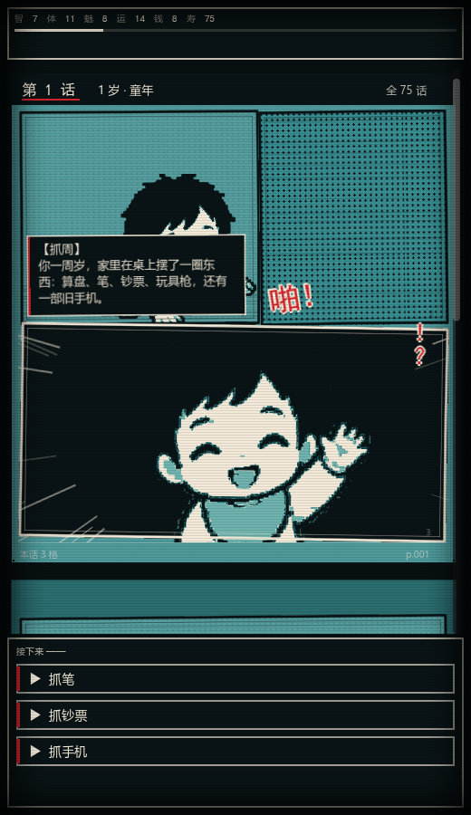

# 竖向漫画流：人生往下长

> 交互参考手机上的纵向漫画：**页面不是一页一页替换，而是一直往下接**。
> 还没活到的年份是空白分镜，活到了才被一格一格填上。



## 怎么读

- 顶部一条**固定状态条**（智/体/魅/运/钱/寿 + 抽象度刻度），不随漫画滚走。
- 中间是**竖向漫画流**：每活一年追加一页，页面之间留 18px 的缝。
- 页面下方永远留着**两页空白分镜**，每格只画框和「未发生」，代表还没轮到的年份。
- 底部一条**固定操作条**放选项与「继续」，选的时候不用往回滚。

## 一次推进发生了什么

1. 选完选项 → 结果页被追加到流的末尾。
2. 新页面先整个空着，然后**逐格显影**：每隔 0.08s 亮一格（`ComicPage.reveal_panels`）。
3. 新页会**顶掉第一个空白位**，同时在末尾补一个新的空白页 —— 空白数恒为 2，所以永远有两页「未来」在下面。
4. 视图用 0.62s 的缓动滚到新页顶部，读起来就是「往下滑一格」，之前的页面留在上面可以回看。


## 实现位置

| 文件 | 职责 |
| --- | --- |
| `comic_panel.gd` | `revealed` 开关：空白格只画框 + 「未发生」 |
| `comic_page.gd` | `reveal_panels(step)` 逐格显影；`blank` 页只有底色和页边 |
| `main.gd` | `_strip_begin` / `_add_blank` / `_append_life_page` / `_scroll_to` / 固定状态条与操作条 |

## 验证

```bash
# 一路点到结局，检查追加、滚动、空白位
godot --headless --path . --script res://tools/smoke_strip.gd
# 输出：strip smoke: pages=39 children=1
```

截图：

```bash
godot --path . --script res://tools/capture_comic.gd -- <输出目录>
# 05_filling.png 就是「新页正在被填」的那一帧
```
