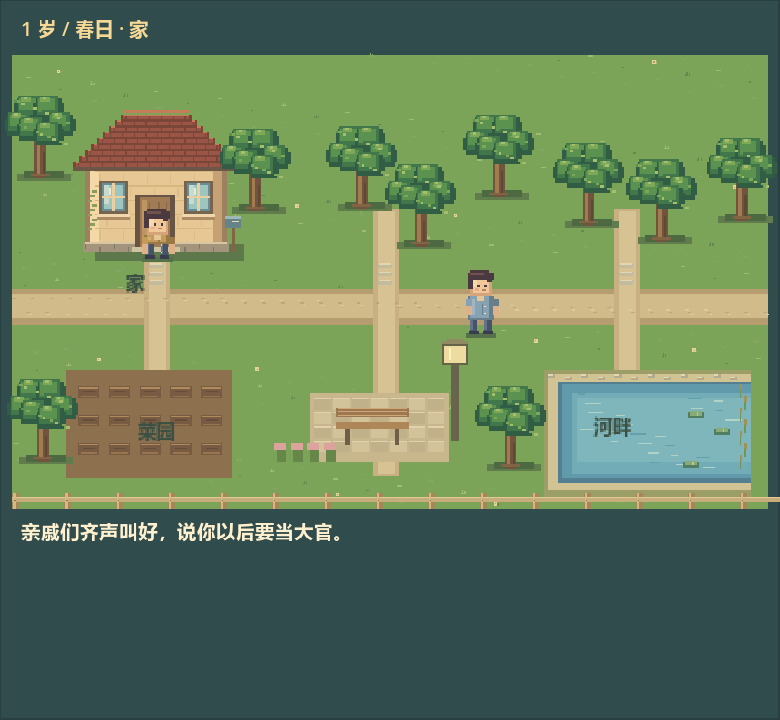
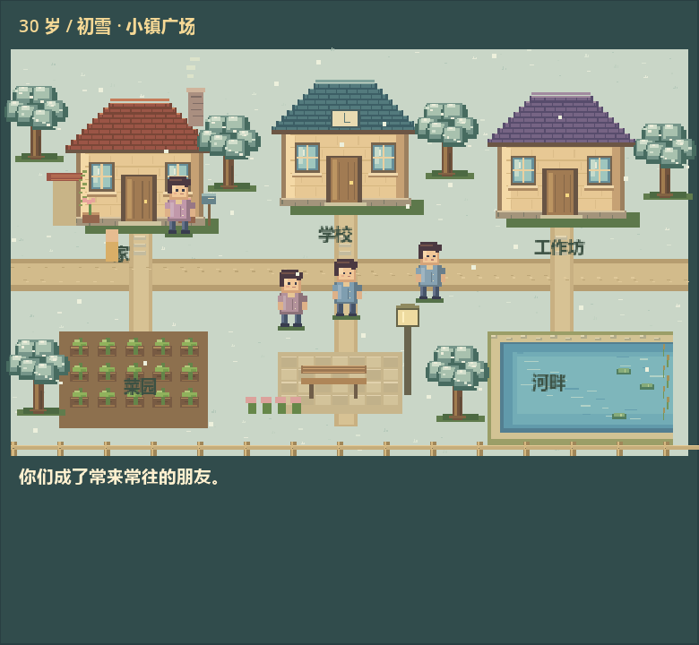
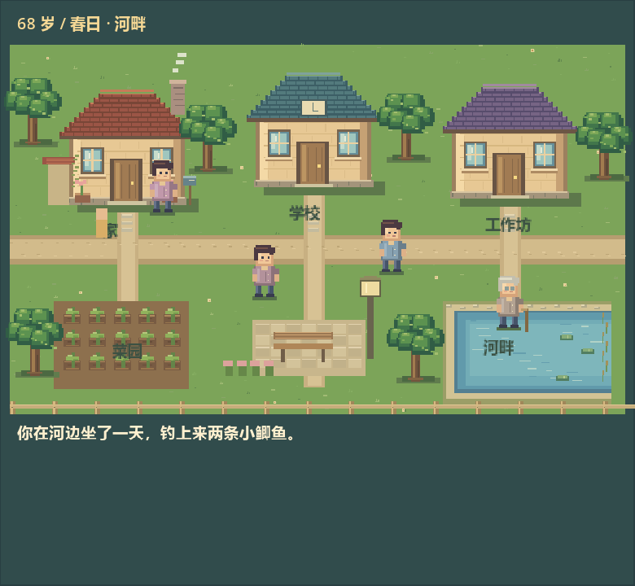

# 随人生演进的生活小镇

使用 Godot 4 打开 project.godot，F5 运行游戏。界面仍按草图分为数值、事件与年龄、选项、动画区。

本次把横向短剧替换为有地面、道路、河流、树木、房屋和邻居的俯视像素小镇。采用 Godot 2D 绘制的立体感像素场景，不是真正的 3D 网格场景。所有图形均在本地渲染，无远程运行依赖；效果道具继续复用 SL 已有的 PixelSRPG-Forge PNG。

## 选择如何成为剧情

每次演出为 5.8 秒，分为走到对应地点、操作道具或与人互动、呈现结果三段。事件名称、所选选项和原始结果文字都参与演出。完成后保留画面与结果，手动继续人生。

抓周分别拿起笔、钞票或手机；读书去学校（学龄前在家）；工作去工作坊；运动或钓鱼去河畔；种菜去菜园；休息回家；交友去广场。看病会出现医生，结婚会出现伴侣互动。拒绝、不去、什么都不学和买房“再等等”会采取不同于接受选项的行动。

剧情编排采用具体里程碑规则、选项语义、事件上下文和属性兜底。当前支持 19 类行为；432 个选项都能被编排，但不等于每项都有独立美术和专属分镜。尚未覆盖的细节会共用基础动作，并用原始剧情文字补全。

## 世界如何成长

GameState.story_world 保存本局地图位置、地点访问、种植、工作、朋友、家庭和人生足迹。主 UI 重建后仍引用同一个世界。

- 年龄改变人物体型、服装与老年白发、手杖；6 岁出现学校，18 岁出现工作坊，提前求学或工作也可提前出现。
- 每八岁轮换一个季节；树叶、草地、雪景随季节变化。这是人生时间的视觉压缩。
- 种菜留下作物并逐次长大；反复工作升级工作坊；财富增长或买房留下住宅扩建。
- 交友增加广场上的朋友，婚礼留下伴侣，生娃事件留下孩子。
- 每局世界持续到这一生结束。重新开始会创建新世界；当前不支持退出应用后恢复未完成的人生。

## 验证与预览

Godot 4.7.2 headless / OpenGL 验证：

```
godot --headless --path . --script res://test/story_smoke.gd
godot --headless --path . --script res://test/world_smoke.gd
godot --headless --path . --script res://test/ui_progress_smoke.gd
```

检查全部行为、所有 432 个选项路由、不同抓周道具、买房/等待、婚礼、生娃、作物、朋友、重建后保留与新局重置、晚年钓鱼，以及重复点击保护、完整播放后解锁继续、下一事件推进。已修复空标签容器未释放问题，当前 UI 与小镇回归测试均无此警告。

world_smoke 的非 headless 模式会导出三个实际渲染画面。测试用既有事件构造人生阶段，不能当作正常随机游玩顺序。





## 点击选项后无法继续的修复

旧布局把继续按钮放在滚动内容末尾，童年长文本等情况下自动滚动仅露出剧场，按钮落在可视区域下方。现在继续按钮独立固定于窗口底部，播放期间显示剩余秒数，完成信号直接解锁按钮。推进后滚动回新事件顶部。真实鼠标事件回归覆盖 520×900、520×640、360×640 窗口与长文本，均验证可点击继续且每次只推进一次。
