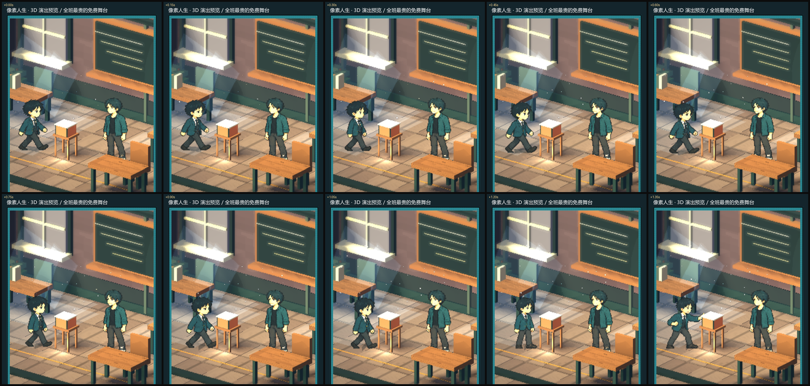

# 动作模组：走位、节奏与场景互动

> 3D 舞台（`pixel_stage_view` + `pixel_billboard_actor`）的动作层。
> 目标：让「走过去 → 做动作 → 物件有反应」读起来是连续的，不是三个 PPT 帧。



## 一、动作模组（`pixel_action_module.gd`）

帧动画决定「形」（换哪张图），模组决定「势」：起伏、前倾、下沉。

| 动作 | 起伏 bob | 前倾 lean | 下沉 drop |
| --- | --- | --- | --- |
| idle | 0.006 | 0° | 0 |
| walk | 0.030（向下踩） | 3.2° | 0 |
| run | 0.045 | 7.0° | 0 |
| talk | 0.007 | 0.8° | 0 |
| reach / offer / receive | 0.003 | 1.6–2.4° | 0 |
| wave / nod | 0.005 | 1.2° / 0.6° | 0 |
| read / phone | 0.003 | 0.4–0.8° | 0 |
| draw / sign / drum | 0.003–0.004 | 1.8–2.2° | 0 |
| **sit** | 0 | 1.2° | **0.22** |
| stand | 0 | −1.2° | 0 |

`sample(action, phase, speed_ratio)` 返回 `{bob, lean, drop}`；`blend(a, b, k)` 用于动作之间过渡。
走路的 bob 是**负向**（踩地）而不是上下飘，速度越快幅度越大。

## 二、走位流畅度（`_arrive`）

之前是「按时间 smoothstep 直接设位置」——时间一跳，人就瞬移。现在：

1. **速度追目标**：`desired = dir * min(2.6, dist * 7)`，速度以 `1-exp(-10Δt)` 逼近；
2. **起步/刹车**：第一帧位移 < 0.02m，每帧位移被 2.6m/s 压住，到点自动归零；
3. **步态相位**：`phase += 实际位移 * 1.6`，走多远迈多少步，帧率不再写死；
4. **原地走**：CG 里没有位移时相位仍按时间推进，画面不定格；
5. **转向**：朝向用 `lerp_angle(..., 1-exp(-9Δt))`，不会瞬间转身；
6. **前倾**：`speed_ratio = clamp(speed/1.1, 0.45, 1.6)`，走越快前倾越大。

## 三、场景互动

- 点击人物/物件 → `perform_interaction()` → 走近（0–1.25s）→ 做动作（1.25s 起）。
- 交互完成时 `_reaction_bump()`：非手持物件（盆栽/冰箱/长椅）会**晃一下 + 轻微挤压回弹**。
- `sit` 动作带 0.22m 下沉，读起来像坐下，而不是站着平移。

## 四、验证

```bash
godot --headless --path . --script res://test/pixel_motion_smoke.gd
# PASS: action module, smooth locomotion, actor pose
```

断言覆盖：走路 bob 为负、速度越快幅度越大、坐下有下沉、过渡取中间值、
`_arrive` 起步不瞬移、每帧位移有上限、最终落点、演员的 bob/lean/drop 生效。

连拍：

```bash
godot --path . --script res://tools/capture_motion.gd -- <输出目录>
```

## 五、还没做的

- 角色只有 4 帧，走路仍是「1 张走路图 + 相位换图」，没有真正的步态循环。
- 没有脚部 IK，斜坡/台阶上会浮。
- 物件反应是通用「晃一下」，没有按种类分化（冰箱应该开门、椅子应该被拉开）。
