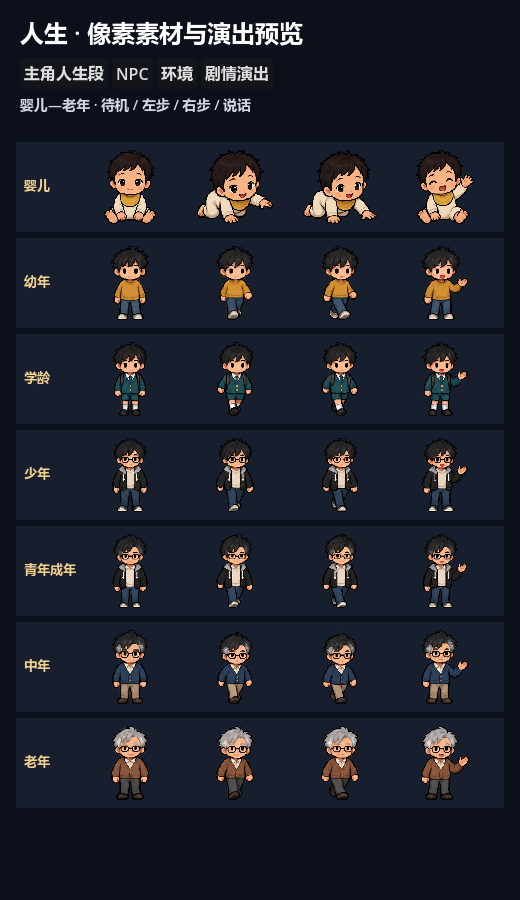
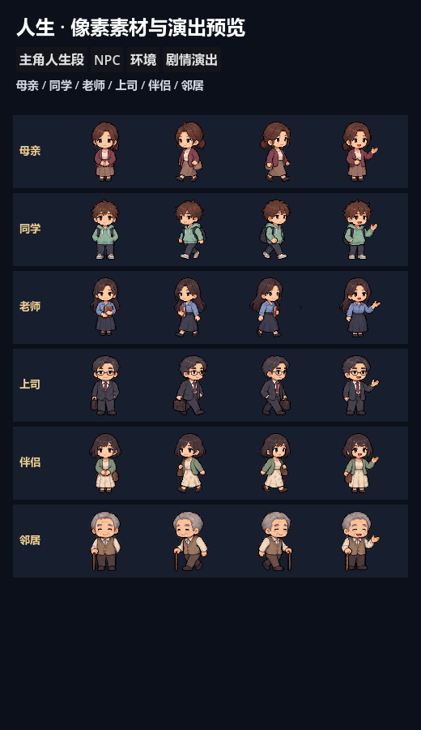
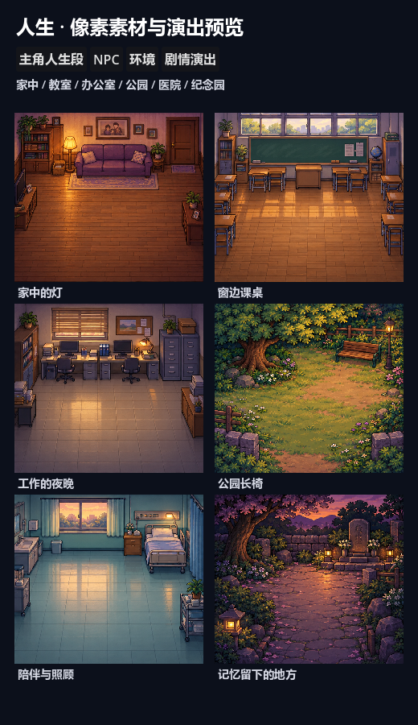
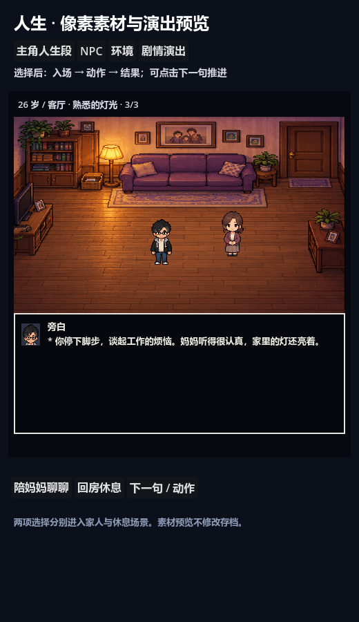
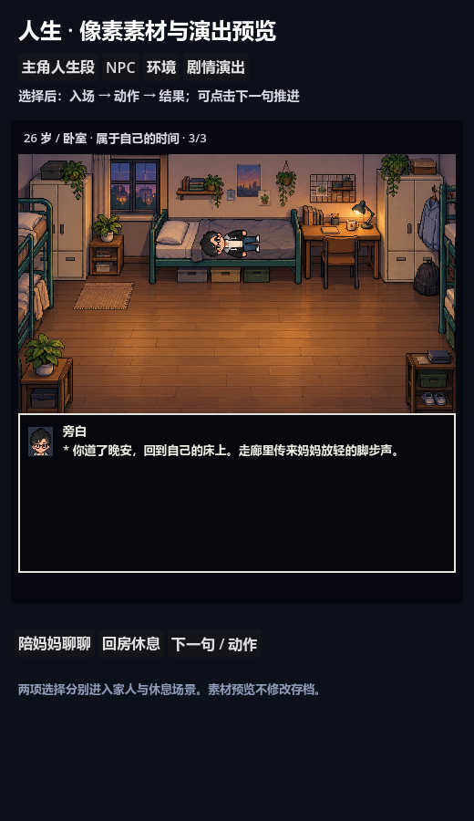

# 人生像素素材 · 第一版

制作原理、生成规范、Godot 动画流程与排错方法见 [动画制作技术总结](animation-production-guide.md)。

已接入 Godot 的素材基础版，制作方式是内置 image_gen，完整提示词在 [prompts.json](../assets/portraits_v2/prompts.json)。用户照片仅用于外形与宿舍特征参考，原始照片没有复制到仓库。

## 查看与试玩

打开本仓库的 `project.godot`，选择 `scenes/PixelCastGallery.tscn`，按 **F6**。主角、NPC、环境标签可以查看素材；剧情演出标签可选择「陪妈妈聊聊 / 回房休息」，播放对应三段动作，点击「下一句 / 动作」可补全文字或推进。预览不修改玩家存档。正常游戏仍按原来的事件与选项运行。

## 素材与接入

- 主角七个阶段：婴儿（0–2）、幼年（3–6）、学龄（7–12）、少年（13–18）、青年成年（19–40）、中年（41–60）、老年（61+）。青年成年参考照片中的黑发、眼镜、灰色帽衬与黑外套。
- 六个 NPC：母亲、同学、老师、上司、伴侣、年长邻居。已有 V13 的父亲暂复用年长男性外形。
- 每个角色四个基础姿态，共 52 帧：静止、两种迈步/婴儿爬行、说话抬手。运行时以 `0→1→0→2` 播步态，以 `0↔3` 表现说话。属于首版基础姿态，尚无完整四方向、坐下、拥抱、哭泣等专用动作。
- 七处环境：家中、教室、办公室、公园、医院、纪念园，以及参考照片宿舍特征的卧室。纪念园可在预览中查看，未强行改写原有事件去使用它。
- `pixel_cast.gd` 加载图集、裁切区域、头像，脚底位置为绘制锚点，最近邻过滤。`regions.json` 记录 alpha>=128 的角色可见边界，原图不被裁剪或改写。生成图存在少量低透明度边缘，当前以原始 alpha 显示。
- `cutscene_stage.gd` 接入新背景、说话头像、入场步态；保留原来的逐字、锁定选项和结算接口。背景逻辑空间为 160×120，已有角色脚底坐标继续生效。
- `story_room.gd` 接入新角色与背景，保留其余专用房间、道具动作、三段推进与世界状态结算。卧室休息会将角色横向放置在床上，尚无专用躺下过渡帧。
- 旧分件素材与 `SpriteKit.compose()` 保留，新的角色图集作为新版显示路径。

## 参考来源

已整理并核实以下页面中的资源分类与图集信息，供继续研究帧数、轮廓和房间构图：

| 来源 | 参考用途 | 本次状态 |
| --- | --- | --- |
| [Undertale 总目录](https://www.spriters-resource.com/pc_computer/undertale/) | 人物、背景与场景资源索引 | 已读取目录 |
| [Frisk](https://www.spriters-resource.com/pc_computer/undertale/asset/75941/) | 步行方向、少帧动画的资源组织 | 已核实 PNG 图集与动画索引 |
| [NPCs / Monster Overworlds](https://www.spriters-resource.com/pc_computer/undertale/asset/79418/) | NPC 轮廓与角色区分 | 已核实图集页面 |
| [Home and New Home](https://www.spriters-resource.com/pc_computer/undertale/asset/76337/) | 家居场景与道具分类 | 已核实图集页面 |
| [UNDERTALE: Kindred Spirits](https://gamejolt.com/games/undertale-kindred-spirits/145217) | 用户指定的剧情演出参考 | 普通页面无可读正文，SSR 页面返回 403；未声称完成试玩或镜头分析 |

Spriters Resource 原图的二进制下载受到站点防护，未得到可用 PNG，因此没有将网页响应伪装成素材收入仓库。此次可运行素材是原创生成图，不是拆取游戏图像。原作资源的权利归属不因被收录于素材站而改变；后续若直接使用原图，应记录对应来源和使用条件。

## 细度目标与实际边界

可以以《传说之下》的逐字对白、少帧动作、人物走位和环境叙事为目标。本版交付的是角色与环境基础，加上可播放的选择演出；不能据此称完整游戏的剧情动画已经达到同等完成度。还需要为具体剧情逐场补表情、动作、停顿、镜头、音效及道具前后遮挡，并逐场人工检查，不能只靠增加像素数。

## 验证

`test/pixel_assets_smoke.gd` 验证七阶段、六类 NPC、52 帧边界、七处环境与两条示例选择均能完成；非 headless 运行时输出上述四张真实 Godot 截图。另运行 `cutscene_smoke`、`room_sequence_smoke`、`story_smoke`、`ui_progress_smoke`，检查已有剧情与点击推进。
