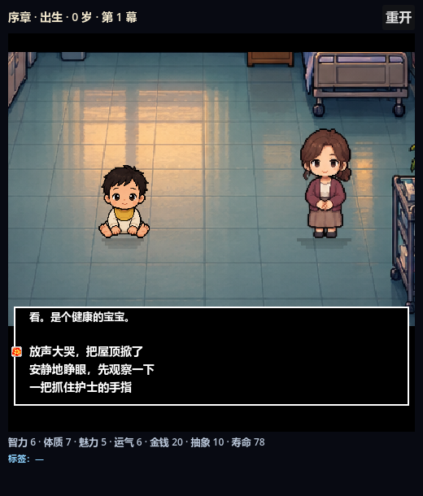
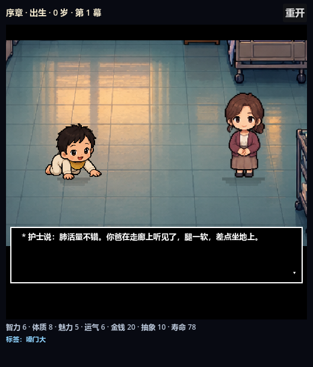

# 项目进度汇报 · 2026-10-18

> 仓库：`gamelife-1.2`（SL 仓库）
> 分支：`master` ｜ 提交：`79052bd` ｜ 已推送 `origin/master`
> 本文只写**能复现、可验证**的东西；做不到的部分单独列在「已知问题」里。

---

## 1. 一句话结论

游戏已经从一个「能玩但不直观」的 HTML 试玩，推进到 **Godot 里可运行、可截图、可回归测试的「序章 + 人生池」demo**。
本轮（10-18 夜）把 demo 的对话框、选项、文字节奏和窗口布局修到「能看」的水平，并补上了整套截图与回归验证手段。

---

## 2. 项目是什么

中文文字人生模拟器：从出生开始，按选项推进年龄、属性、标签与关系，最后结算一生。
表现层走 **Undertale / Deltarune 风**：`*` 开头无名字旁白、逐字打字、红心选择、黑框高对比、镜头推近与 letterbox。

---

## 3. 当前状态快照

| 项 | 数字 | 说明 |
| --- | --- | --- |
| GDScript（主工程） | 18 个文件 / 6098 行 | `scripts/` |
| GDScript（独立 demo） | 9 个文件 / 2201 行 | `godot_demo/scripts/` |
| 剧情节点（序章） | 62 个 | `data/story_opening.json` |
| 序章选项 | 146 个 | 含条件分支 |
| 人生事件 | 200 个 | `data/game_data.json` → `EVENTS` |
| 过场脚本 | 9 个 / 62 段反应对白 | `data/story_cutscenes.json` |
| 结局 | 32 种 | `ENDINGS` |
| 成就 | 13 个 | `ACHIEVEMENTS` |
| 角色 | 7 阶段 + 6 NPC = 52 帧 | SL 库图集，每人 4 帧 |
| 房间 | 7 个 | 6 个房间格 + bedroom 单格 |
| 回归测试 | 12 个 headless | `test/*.gd` |
| 文档 | 13 篇 | `docs/*.md` |

---

## 4. 模块进度

### 4.1 剧情与分支 —— 可用

- 序章 62 节点、146 选项，支持 `next` 字符串 / `when[{tags,next}]` 条件跳转。
- 人生池 200 事件，按年龄区间、标签条件、权重抽取，最多 34 幕。
- 9 个专属过场（OP01–OP11 序章段落 + V03/V13 人生事件 + C33/C34 联动），带镜头、站位、逐拍对白。
- 其中 7 个过场带 62 段角色反应对白（`reactions`，按选项文案索引）。

### 4.2 角色与动画 —— 受素材上限约束

- 数据源：SL 库 `assets/portraits_v2/`，`regions.json` 切图，按脚底中心锚定。
- 每人 **4 帧**：静止 / 走 A / 走 B / 说话抬手；走路循环 `[0,1,0,2]`。
- 绘制层补间：上下浮动、眨眼、口型，**12fps 量化**，读起来像逐帧而不是连续飘。
- 明确限制：**4 帧是素材上限**，程序补间变不出第 5 帧。

### 4.3 房间与背景 —— 可用

- `environment-atlas.png` 1536×1024，按 512 网格切 3×2；`bedroom.png` 同样按格切。
- 过场取 512×288（16:9）再等比缩放，人物与背景共用同一 camera 变换。

### 4.4 Godot demo —— 可玩

- 独立工程 `godot_demo/`，F5 直接运行，不依赖主工程启动流程。
- 流程：序章分支 → 人生池 → 结算（综合分 + 评级 + 回忆列表）。
- 表现：camera 推近、letterbox、闪白/闪黑、逐字、红心选择、结果反应。

### 4.5 测试与工具 —— 已成体系

- 12 个 headless 回归，覆盖序章结构、选项解锁、过场联动、房间序列、像素资源、UI 进度等。
- 本轮新增 `godot_demo/tools/capture_demo.gd`：跑一遍 demo，输出 6 张关键节拍截图。
- 空池保护：`_pick_life_event` 抽空时清空 `seen` 再抽，避免递归死循环。

---

## 5. 最近四轮工作（按提交）

| 提交 | 内容 | 产物 |
| --- | --- | --- |
| `58b8190` | 应用 SL 库背景技术，手绘房间整图取代程序化场景壳 | `assets/rooms/`、`_make_rooms.py` |
| `23353d9` | 三岁前可玩 demo，过场 + `pixel_cast` 结合 | `scenes/StoryDemo.tscn` |
| `4db04d4` | 传说之下式文本、子帧动画、选择后反应 | `docs/undertale-style-preview.png` |
| `60b35e6` | 生成独立 Godot demo 工程 | `godot_demo/` |
| `79052bd` | **本轮**：选项/对话框/文字节奏/布局 | 见第 6 节 |

---

## 6. 本轮改动（`79052bd`）

### 6.1 修掉的真问题

| 问题 | 之前 | 现在 |
| --- | --- | --- |
| 选项压住立绘 | 选项从框底往上排，x 写死，正好盖在 62px 头像上；只剩一个「继续」时几乎看不见 | 选项独立成栏，排在提示语下方，红心在文字左侧 |
| 长句溢出 | 对话框固定 92px，30 字以上结果句贴到边框 | 按行数算高度（最小 92），最多 5 行 |
| 旁白戴头像 | 旁白 beat 也显示主角立绘 | 只有具名角色才有头像和名字 |
| 结果页像菜单 | 结果要再选一个「继续」 | 读完最后一句点一下就走 |
| 逐字一个速度 | 每字 0.045s，标点同速 | 句末 0.26s / 逗号 0.11s，标点不发声 |
| 位移连续飘 | 浮动/眨眼跟 60fps 连续变 | 量化到 12fps，踩画格 |
| 下半屏黑板 | 窗口 520×760，内容只占上半 | 窗口 520×610、舞台 490 |
| 结算平淡 | 评级混在正文第一行 | 评级 26px 居中，按等级着色 |

### 6.2 前后对比

| 选项页 | 结果页 |
| --- | --- |
|  |  |

### 6.3 工程侧

- 排版统一由 `_box_metrics()` 计算，**绘制与点击命中共用一份数据**，避免「看到的」和「点到的」错位。
- 主仓库 `scripts/` 与 `godot_demo/scripts/` 已同步（两份副本，见风险 R3）。

---

## 7. 验证

```bash
# 全部 12 个回归
godot --headless --path . --script res://test/demo_trial_smoke.gd
# 逐个跑：test/*.gd，12 个全部 PASS
```

结果：

| 测试 | 结果 |
| --- | --- |
| demo_trial_smoke | PASS，序章→人生池→结算，44 次选择 |
| cutscene / opening / linkage / story / world / room_sequence / pixel_assets / animation_link / ui_progress / demo_pre3 / opening_ui | 全部 PASS |

截图复现：

```bash
godot --path godot_demo --script res://tools/capture_demo.gd -- <输出目录>
```

---

## 8. 已知问题与风险

| 编号 | 问题 | 影响 | 处置建议 |
| --- | --- | --- | --- |
| R1 | 角色只有 4 帧 | 「增加帧数」只能靠补间，动作幅度有限 | 回 SL 库补素材，或接受当前精度 |
| R2 | 人生池选项后没有反应对白 | 序章有 62 段反应，200 个人生事件没有；选完只有一句旁白 | 批量补 `reactions` 数据（写作活，不是代码活） |
| R3 | 主仓库与 `godot_demo/` 是两份副本 | 改一处要手动同步，容易漂移 | 长期应写生成脚本，从主仓库导出 demo |
| R4 | 评级规则：15 岁前死亡一律「拉完了」 | 幼年夭折时读起来像 bug | 属既有规则，是否改文案待定 |
| R5 | 本机沙箱命令写不进子目录 | 影响 `cp`/`rm`/`git add`，需切完全权限 | 环境问题，与项目代码无关；诊断报告在 `_acl-report/` |
| R6 | SaveManager 在无 `user://` 写入权限时报错 | headless 环境下刷错误日志，不影响流程 | 低优先级，可加降级 |

---

## 9. 下一步建议

| 优先级 | 事项 | 说明 |
| --- | --- | --- |
| P0 | 人生池反应数据 | 直接把「选择后互动」从序章铺到全程，收益最大且不动代码 |
| P1 | 结算页与标题页 | 结算已是独立画面；标题页仍缺，进游戏略显突兀 |
| P2 | 主仓库 → demo 的生成脚本 | 消除双份副本，避免后续改动漏同步 |
| P2 | 音效与 BGM | 目前只有合成打字音，氛围偏干 |

---

## 10. 复现方式

```bash
# 主工程
godot --path gamelife-1.2

# 独立 demo
godot --path gamelife-1.2/godot_demo

# 回归
cd gamelife-1.2
godot --headless --path . --script res://test/<name>.gd
```

---

## 附录 A · 提交时间线（近 12 条）

```
79052bd fix(demo): 选项不再压住立绘，对话框按内容定高
60b35e6 feat: generate a standalone Godot demo project
4db04d4 feat: Undertale-style text, sub-frame animation and post-choice reactions
f005637 fix: match the classic demo's initial stats and preview
3a6cdcd feat: port the classic HTML demo into a Godot DemoTrial scene
6491663 feat: scale backdrop and cast as one scene camera
23353d9 feat: add playable pre-3 story demo combining cutscenes and pixel_cast
1f50863 fix: render cutscene characters with the latest pixel_cast atlas
b97bffd feat: drive cutscene story beats with frames.json animation data
e7da4bf docs: avoid branch-only route link on master
1824a14 docs: enrich story bible, prologue, arcs and cutscene scripts
58b8190 应用 SL 库的背景技术：手绘房间整图取代程序化场景壳 + 道具层
```

## 附录 B · 文件地图

| 路径 | 作用 |
| --- | --- |
| `scripts/cutscene_stage.gd` | 过场舞台：背景、角色、对话框、选项、打字节奏 |
| `scripts/demo_trial.gd` | 序章 + 人生池流程与结算 |
| `scripts/game_controller.gd` | 选择结算、标签、关系、成就 |
| `scripts/pixel_cast.gd` | 角色/房间图集切图 |
| `godot_demo/` | 独立可运行 demo（含数据、素材、截图工具） |
| `data/*.json` | 剧情、事件、过场、联动剧本 |
| `docs/demo-trial-godot.md` | demo 的详细说明与改动记录 |
| `test/*.gd` | 12 个 headless 回归 |
