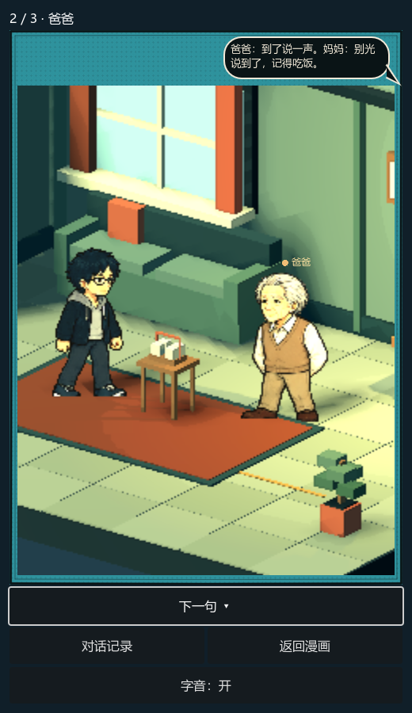

# 场景人物交流技术



目标：参考《风来之国》人物交流的表现方向，把对白放回人物所在的场景，让说话、倾听和玩家阅读形成有节奏的往返。以下是本项目原创实现方案，不是该游戏内部技术的复刻。

## 玩家操作

在新剧情漫画的选项区点击「人物对话 · 逐句观看」。点击画面、推进按钮或空格／回车，第一次补全正在打出的句子，下一次进入下一句；最后一句后返回漫画。也可随时返回，中途位置会随书签保存。对话记录只显示已到达的句子和当前已显示的文字，不展示后续内容。打开记录时暂停打字。

「字音」可关闭。这里是短促的合成提示音，不是配音或语音识别。旁白不播放人物字音，明确标为一言不发的对白也静音。正式人生选择始终在漫画选项区完成。

## 状态与数据

```text
显示句子 → 逐字中 → 等待玩家 → 下一句 → 结束／返回漫画
              ↓                 ↓
           显示整句          查看已读记录
```

`scene_conversation.gd` 接收现有页面的 `panels` 数组，不重新生成台词。每项沿用：

| 字段 | 含义 |
| --- | --- |
| text_channel | dialogue 为角色对白，narration 为旁白 |
| speaker_label | 显示姓名，与美术角色槽位分开 |
| actor / support | 当前说话者与场上 NPC 素材 |
| bubble / caption | 人物气泡／旁白框，保持两种表达分离 |
| action / performance | 已有导演动作、表情、文字停顿与触发时刻 |
| conversation_progress | 当前行号、显示字数、是否看完；只影响展示 |

首次选择前只播放已有开场内容，避免替主角说出尚未选择的答案。选择后重看时，将同年龄同事件的开场与实际结果按顺序连接，形成「对方说话 → 玩家已选回答 → 实际后果与旁白」的完整交流。重播不会重新结算选择或消耗人生随机数。

## 演出配合

二维人物仍由 `pixel_billboard_actor.gd` 放在真实 3D 场景中。说话者上方显示姓名与暖色标记，人物气泡按说话者分侧显示。打字期间用现有全身姿势交替表现说话；听者保持面对对方，稍晚出现轻微点头动作。减少动态模式禁用这些额外起伏。当前是全身姿势动画，没有声学口型同步。

同房间、同角色组合、同道具的连续句子复用场景；角色或场景改变才释放并重建。交流期间暂停漫画背景中的场景显示，避免两套视口争抢预算。CG 和观察动作在逐句模式中停用，各自在漫画入口操作，防止同时抢占角色动作。

字音使用项目自带的短音合成方法，根据角色标识确定音高；每次声音至少间隔 75 毫秒。补全整句不会集中补播所有字符声音。

## 存档与边界

对话位置写入页面 `conversation_progress`，正常返回、保存书签和窗口关闭时保存；读档保留原有剧情、健康数值与随机流。旧书签没有此字段时从第一句开始。看完后再次打开从头重播。

本次没有重写所有事件为长篇多轮对话，也未增加 AI 即兴聊天。事件能有多少往返取决于已写入的台词；技术支持不同角色连续说话。场景仍使用现有角色贴图，完整八方向转身与独立嘴型帧属于后续美术内容。

## 验证

`test/scene_conversation_smoke.gd` 通过真实阅读器按钮检查补全／推进、中途关闭、磁盘书签恢复、记录暂停、360 宽度、结果页双方对白和随机状态不变。另回归 `life_comic_ui_smoke`、`pixel_reader_smoke`、`pixel_stage_smoke`。

参考入口：[Eastward 官方网站](https://eastwardgame.com/)。本文的状态机、操作与资源管理是本项目设计，并不把这些功能归因为参考游戏的实际实现。
