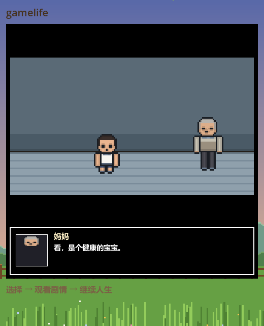
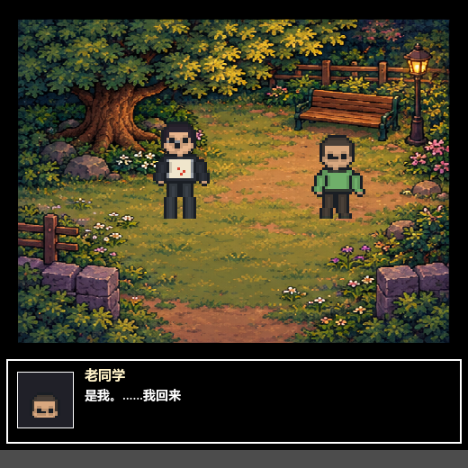

# Undertale 式剧情过场时间轴

> 数据文件：[`data/story_cutscenes.json`](../data/story_cutscenes.json)。
> 渲染：[`scripts/cutscene_stage.gd`](../scripts/cutscene_stage.gd) + [`scripts/sprite_kit.gd`](../scripts/sprite_kit.gd) + [`scripts/audio_fx.gd`](../scripts/audio_fx.gd)。
> 素材：[`assets/chars`](../assets/chars)、[`assets/scenes`](../assets/scenes)。
> 剧情数据仍在 GitHub 仓库 **SL**（`gulegegezi/SL`）。
> 叙事总纲与人物小传见 [story-bible.md](story-bible.md)。





## 这是什么

给事件加一层 **Undertale 式过场**：不再是「文字卡 + 按钮 + 三镜头小剧场」，而是

- 房间图集背景（`PixelCast.room`，160×120 逻辑画布）；
- `assets/chars` 的 24×36 逐帧立绘：`idle / walk / wave / raise / sit`，`idle` 支持 **10 种表情**（normal / happy / sad / angry / surprise / scared / determined / shy / hurt / blink）；
- 角色可以按 `from` / `walk_time` 从场外走进来，走到 `x/y` 后自动切回 `idle`；
- 底部黑框对话框：说话人名字、立绘表情槽、逐字打字 + 合成「滴滴」音；
- 对白结束后的**对话框内选项**，红色心形光标上下移动、回车/点击确认；
- 关系不够的选项会灰色显示并带「需要和…更亲近」提示，无法选中。

## 剧情 × 动画：beat 里的动作字段

`data/story_cutscenes.json` 的对白是剧情，`data/frames.json` 的帧表是动画。两者通过 beat 字段接起来：

| 字段 | 写在哪 | 作用 |
| --- | --- | --- |
| `action` | `beat` 或 `cast[]` | `idle / walk / wave / raise / sit`；写给 `target` 角色，保持到下一次显式切换 |
| `target` | `beat` | 执行动作的角色，默认等于 `face` |
| `face` | `beat` | 对话框立绘是谁（`lead` 或 NPC 角色） |
| `expr` | `beat` | 立绘表情，10 种；`neutral`/`shock` 会自动映射到 `normal`/`surprise` |
| `from` | `cast[]` | 入场起点 `[x, y]`；有此字段时角色边走边播 `walk` |
| `walk_time` | `cast[]` | 入场时长，默认 1.0 秒 |
| `cast[].action` / `cast[].face` | `cast[]` | 该角色的默认动作与表情 |

渲染时按 `frames.json` 的 `fps` 播放对应动作帧；帧表是稀疏的（例如 `idle_2` 只有 blink），取不到精确帧会自动回退到同表情第 0 帧或 normal 帧，不会出现空图。

例子：V03 里老同学从画面右侧走进来，说完“是我。……我回来了”时挥手，下一句再收回 idle。

```json
{"role": "friend", "x": 118, "y": 74, "from": [152, 74], "walk_time": 1.1, "action": "idle"}
{"speaker": "老同学", "face": "friend", "action": "wave", "target": "friend", "text": "是我。……我回来了，想见一面。"}
{"speaker": "你", "face": "lead", "expr": "happy", "action": "idle", "target": "friend", "text": "你这些年，到底去哪儿了？"}
```

## 现在接入了哪些过场

| 事件 | 场景 | 出场 |
| --- | --- | --- |
| `OP01` 序章·出生 | `hospital` | 主角（婴儿）+ 妈妈 |
| `V03` 老同学来电 | `park` | 主角 + 老同学 |
| `V13` 病房走廊 | `hospital` | 主角 + 爸爸 |

## 剧本全文

### OP01 · 出生

**场景**：医院，凌晨四点，雨刚停。灯管嗡嗡响。
**出场**：主角（婴儿，`lead_child`）在左，妈妈（`npc_parent`）在右。
**背景**：`hospital`。

> **旁白**（主角 neutral）：凌晨四点，雨刚停。产房的灯管嗡嗡响，你被一双戴橡胶手套的手倒提着，拍了两下脚心。
>
> **你**（shock）：……
>
> **妈妈**：看，是个健康的宝宝。

**选择**：

1. 放声大哭，把屋顶掀了
2. 安静地睁眼，先观察一下
3. 一把抓住护士的手指

**演出提示**：旁白时主角是 `normal`；切到「你」时换 `surprise`；妈妈说话时立绘切到 NPC 妈妈，并在最后一句做 `wave`。三个选择分别走向 `OP02` / `OP03` / `OP04`，序章内年龄不增长。

---

### V03 · 老同学来电

**场景**：公园，傍晚。手机响了三次。
**出场**：主角（成年，`lead_adult`）在左；老同学（`npc_friend`）从右侧 `from [152, 74]` 走进来，`walk_time 1.1`，停在 `118, 74`。
**背景**：`park`。

> **旁白**（主角 `normal`）：手机响了三次，一个陌生号码。
>
> **你**（`surprise`）：喂？
>
> **老同学**（`action: wave`）：是我。……我回来了，想见一面。
>
> **你**（`happy`，`action: idle`，`target: friend`）：你这些年，到底去哪儿了？

**选择**：

1. 去见他
2. 说最近很忙，改天
3. 问他：你当年为什么走（需要和同桌更熟）

**演出提示**：选项 3 是锁定项，关系不足时灰显「需要和同桌更熟」。选择后分别进入 `V03A` / `V03B` / `V03C`，再由它们汇入 `V04`。这条过场是同桌线的情绪转折点：前三句是试探，最后一句才露出真正的在意。

---

### V13 · 病房走廊

**场景**：医院，凌晨两点。走廊很亮。
**出场**：主角（成年，`lead_adult`）在左，爸爸（`npc_parent`）在右。
**背景**：`hospital`。

> **旁白**（主角 `blink`）：凌晨两点，医院的走廊很亮，亮得人睡不着。
>
> **爸爸**（`action: raise`）：没事，你回去睡吧。
>
> **你**（`sad`，`action: idle`，`target: parent`）：爸，你先回去吧，今晚我守着。

**选择**：

1. 留下来陪床（需要和妈妈更亲近）
2. 去缴费，把手续办完
3. 说：我明天还要上班

**演出提示**：爸爸的台词越轻，越要留停顿；他抬手（`raise`）之后，下一句再收回 `idle`。主角的第一句用 `blink`（走廊太亮），最后一句换 `sad`。选项 1 是锁定项；关系不足时玩家会看到「需要和妈妈更亲近」，这本身就是这场戏的一部分。

## 接下来可以写的过场

- `OP05` 满月酒：一桌亲戚、红包、筷子；适合让 NPC 妈妈/二姨轮流出画。
- `OP11` 抓周：六样东西摆在桌上，适合做「主角走向桌子」的走位。
- `V11` 家长会之后：妈妈拿着成绩单，一路沉默；适合用路灯/楼道灯做镜头。
- `V21` 分科表：笔尖悬在文理两栏之间；适合给一个很长的停顿。
- `V31` 排练室：推开门，看见落灰的钢琴；适合先给空镜，再让主角入画。

## 数据格式

```json
{
  "version": 2,
  "cutscenes": {
    "OP01": {
      "bg": "hospital",
      "cast": [
        {"role": "parent", "x": 118, "y": 74, "action": "idle", "face": "normal"},
        {"role": "lead", "x": 52, "y": 76, "action": "idle", "face": "normal"}
      ],
      "beats": [
        {"speaker": "旁白", "face": "lead", "expr": "normal", "text": "……"},
        {"speaker": "你", "face": "lead", "expr": "surprise", "text": "……"},
        {"speaker": "妈妈", "face": "parent", "expr": "normal", "action": "wave", "target": "parent", "text": "……"}
      ]
    }
  }
}
```

- `bg`：`home / classroom / hospital / office / park / grave / bedroom`。
- `cast[].role`：`lead` 或 `boss / friend / mate / parent / partner / teacher`；`x/y` 是 160×120 逻辑坐标里的脚底位置。
- `cast[]` 可选 `from: [x, y]` 与 `walk_time`，角色会从场外走进 `x/y`；可选默认 `action` / `face`。
- `beats[].face`：对话框立绘是谁；`lead` 按年龄取阶段，`expr` 支持 10 种表情；NPC 目前只有 `normal`。
- `beats[].action` + `target`：让某个角色做 `idle / walk / wave / raise / sit`，动作保持到下一次显式切换。
- **选项不写在这里**：选项沿用事件自己的 `choices`，`main.gd` 会按 `showIf` 过滤、按 `requireRelations/requireTags` 标灰锁定，选择后仍走 `gc.choose` 结算。

## 素材与角色拼装

- 逐帧数据来自 [`data/frames.json`](../data/frames.json)：每个角色 5 种动作，`idle` 支持 10 表情，其余动作只有 `normal`。
- 帧图是 `assets/chars/{lead|npc}_{角色}_{动作}_{帧}_{表情}.png`，24×36 同画布；`fps` 也写在 `frames.json`。
- 帧表是稀疏的（如 `idle_2` 只有 blink），`SpriteKit.action_frame()` 会逐级回退到同表情第 0 帧或 normal 帧。
- 对话框立绘直接裁 `idle` 帧的头部（上 15px），因此 10 种表情在立绘和场上都一致。
- 旧的分件合成 `SpriteKit.compose()` 仍保留，作为没有帧数据时的兜底。
- 音频是运行时合成的方波/正弦短音（`audio_fx.gd`），无外部音频文件依赖。

## 怎么新增一个过场

1. 在 `data/story_cutscenes.json` 的 `cutscenes` 下加一个以事件 id 为键的条目。
2. 事件在随机池/序章/联动里正常触发；`render_main()` 发现 `cutscene_for(id)` 非空就切到过场。
3. 没写过场的事件继续走原来的「文字卡 + 三镜头小剧场」，互不影响。

## 验证

```bash
godot --headless --path . --script res://test/animation_link_smoke.gd
godot --headless --path . --script res://test/cutscene_smoke.gd
godot --headless --path . --script res://test/opening_ui_smoke.gd
godot --headless --path . --script res://test/linkage_smoke.gd
godot --headless --path . --script res://test/opening_smoke.gd
godot --headless --path . --script res://test/story_smoke.gd
godot --headless --path . --script res://test/room_sequence_smoke.gd
godot --headless --path . --script res://test/ui_progress_smoke.gd
godot --headless --path . --script res://test/world_smoke.gd
```
