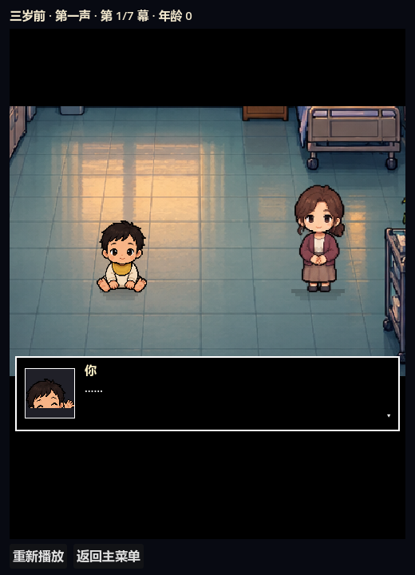

# 三岁前 · 试玩动画

> 场景：[`scenes/StoryDemo.tscn`](../scenes/StoryDemo.tscn)
> 控制：[`scripts/story_demo.gd`](../scripts/story_demo.gd)
> 顺序：[`data/story_demo_pre3.json`](../data/story_demo_pre3.json)
> 对白：[`data/story_cutscenes.json`](../data/story_cutscenes.json)
> 角色：[`scripts/pixel_cast.gd`](../scripts/pixel_cast.gd) + [`assets/portraits_v2`](../assets/portraits_v2)



## 这是什么

一段可以从出生玩到三岁的短篇试玩：

- 7 幕连续对白动画，全部使用最新的 `pixel_cast` 角色图集与手绘房间；
- 每幕对白结束后，事件自己的选项会出现在对话框里，红心光标上下选择；
- 选中后先用一段旁白镜头演出「结果」，再进入下一幕；
- 选择会影响标签、羁绊和「你记住的瞬间」，最后在三岁总结里回看；
- 不写存档，点「重新播放」可以反复试。

## 开始方式

1. 打开项目，运行 `Main`，在标题页点 **试玩 · 三岁前**；
2. 或直接打开 [`scenes/StoryDemo.tscn`](../scenes/StoryDemo.tscn)，按 **F6**。

## 七幕

| 幕 | 事件 | 过场 | 年龄 | 选择 |
| --- | --- | --- | --- | --- |
| 第一声 | `OP01` | `OP01` | 0 | 大哭 / 睁眼观察 / 抓住护士手指 |
| 满月 | `OP05` | `OP05` | 1 | 抓筷子 / 睡红包 / 对每个亲戚笑 |
| 第一个词 | `OP09` | `OP09` | 1 | 妈妈 / 爸爸 / 不 |
| 第一步 | `OP10` | `OP10` | 1 | 扑向爸爸 / 扑向妈妈 / 自己走到门口 / 蹲下不走 |
| 抓周 | `OP11` | `OP11` | 1 | 毛笔 / 钞票 / 听诊器 / 拨浪鼓 / 手机 / 桂花糕（隐藏） |
| 一岁半的午后 | `C33` | `C33` | 2 | 够乒乓球 / 叫妈妈 / 继续往里爬 |
| 两岁的雨 | `C34` | `C34` | 2 | 数水珠 / 拍窗户 / 发呆 |

## 剧情和动画怎么结合

- **对白**：`story_demo_pre3.json` 按顺序给出 `event` 与 `cutscene`，`story_demo.gd` 把两者交给 `CutsceneStage`。
- **角色**：`pixel_cast` 的 7 个阶段 + 6 个 NPC，每人 4 帧（静止 / 两帧走 / 说话抬手）；婴儿阶段自动使用 `infant` 图集。
- **场景缩放**：背景与人物共用同一个 camera（160×90 逻辑场景、512×288 房间裁剪、脚底 `floor_y=62`），人物随场景一起缩放/推拉，脚下有软阴影；每个过场可用 `camera.zoom/x/y` 单独取景。
- **动作**：cutscene 的 `action` / `target` 驱动走路、抬手与静止；`from` / `walk_time` 可以让人物从场外走进来。
- **选择**：选项直接取自事件数据（`OP01`/`OP05`/`OP09`/`OP10`/`OP11`/`C33`/`C34`），不在这里复制一份；`showIf` 隐藏、`require*` 锁定的规则继续生效。
- **结果**：选择后用同一个背景与角色，播一段只有旁白的「结果」镜头，再进入下一幕。
- **回响**：满月选「抓筷子」会写入 `吃货`，抓周时才会出现隐藏选项「桂花糕」；所有选择都会进入三岁总结的「你记住的瞬间 / 留下的性格 / 羁绊」。

## 和三岁之后的区别

这是一个**独立的试玩场景**，不写存档、不影响正式人生。正式流程仍然从标题页的「开始人生」进入，随机出生、随机事件、四岁以后继续。

## 验证

```bash
godot --headless --path . --script res://test/demo_pre3_smoke.gd
godot --headless --path . --script res://test/animation_link_smoke.gd
godot --headless --path . --script res://test/cutscene_smoke.gd
```

`demo_pre3_smoke` 会实际实例化 `StoryDemo`，从头播完 7 幕、每幕确认选项，并检查最后出现「年龄：3 岁」的总结。
