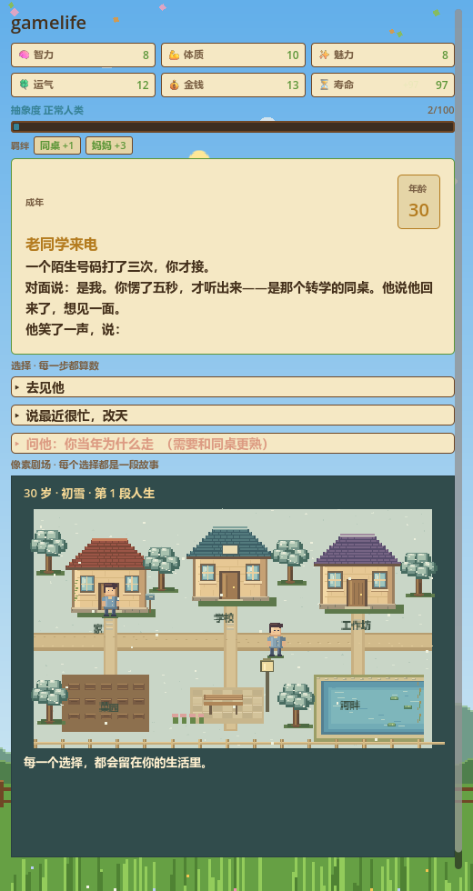
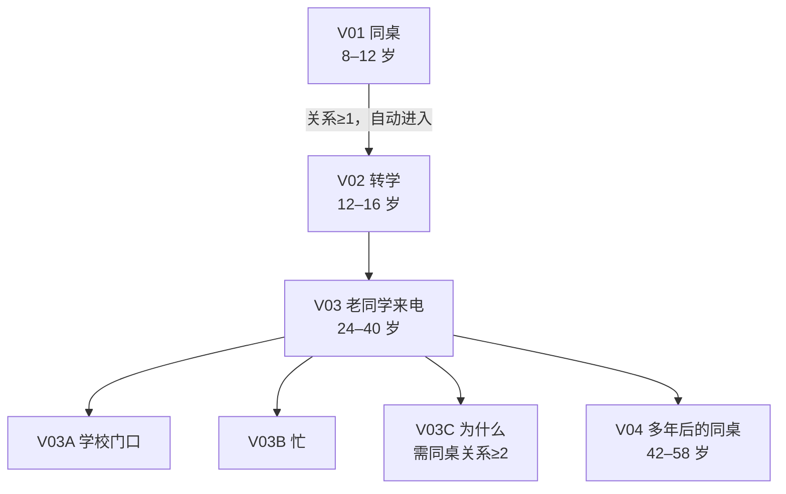
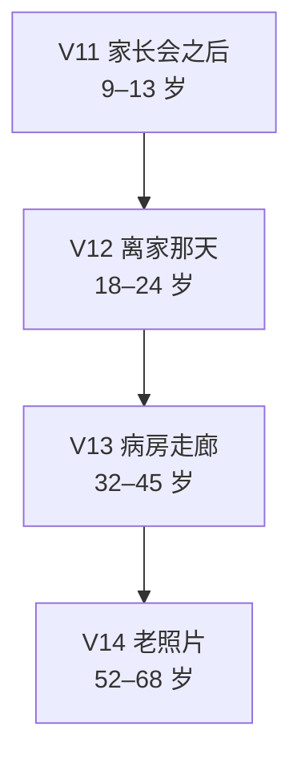
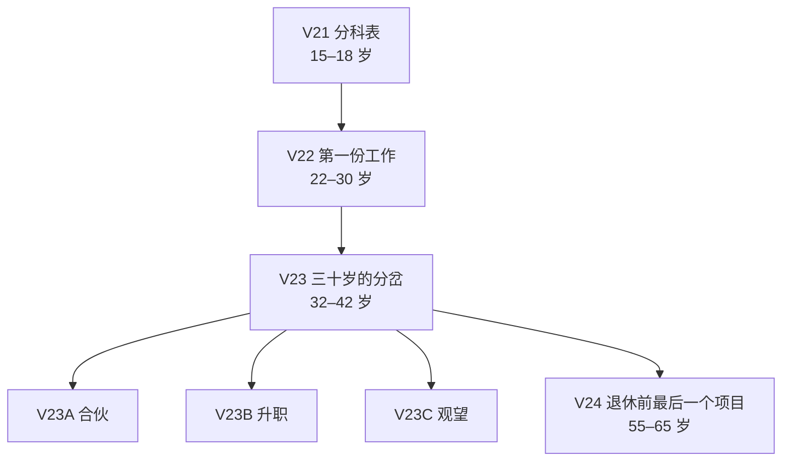
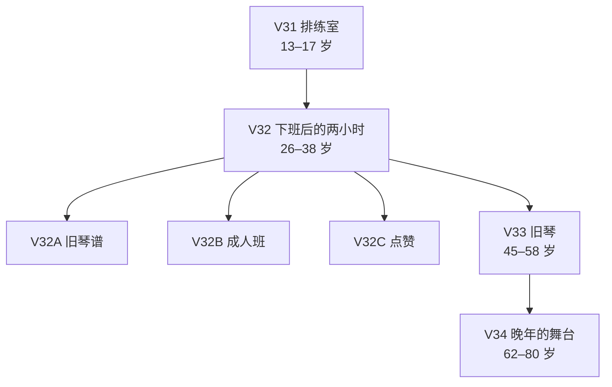

# 选项联动剧本：四条人生线

> 数据文件：[`data/story_arcs.json`](../data/story_arcs.json)。
> 和序章一样，所有剧情数据都存放在 GitHub 仓库 **SL**（`gulegegezi/SL`）。
> 叙事总纲见 [story-bible.md](story-bible.md)，序章全见 [story-opening.md](story-opening.md)。



## 这次做了什么

- 新增 **4 条跨年龄段剧情线**：同桌、父母、学业/职业、爱好。
- 每条线 **4 个主事件**，从少年/青年一直延伸到中年/晚年；前一个选择会写入标签与关系值，后一个事件只有在你走过前一段时才会出现。
- 新增 **9 个“那之后”分支节点**，把关键选择的即时后果演完。
- 选项可以带 `relations`（人物关系值）、`memory`（给未来剧情回忆的短句）、`requireRelations` / `requireTags`（没满足条件时显示为灰色锁定项）。
- 事件文本支持 `{choice:V01}` 这样的占位符，会替换成你当时的选择记忆，例如：
  “他笑了一声，说：我一直记得，{choice:V01}。”
- 关系值会显示在顶栏的“羁绊”一行；负值也会显示。

## 四条线怎么串起来

### 同桌线：那块切了一半的橡皮

新学期的座位表把你安排在一个总把橡皮切成小块的同桌旁边。他把其中一块递给你，说：这样就不容易丢了。

这是你第一次遇到「别人主动分给你一点什么」。你可以也把自己的橡皮切一半给他，可以说声谢谢但没说话，也可以说：我不用橡皮。三个选择都不大，但它们决定了这个人以后会不会把更重要的事告诉你。

后来他告诉你一个秘密。你可以替他守着，可以告诉他「我爸妈也吵过架」，也可以偷偷告诉老师。再后来，初二下学期，他的座位空了。班主任说他转学了，走得很急。你翻开笔盒，那块切了一半的橡皮还在。

你可以给他写信，寄到旧地址；可以把橡皮收进铁盒；也可以什么也不做。信可能没有回音，铁盒可能一直放在抽屉里，座位很快会被新同学填上。

很多年后，一个陌生号码打了三次。你接起来，对面说：是我。你愣了五秒，才听出来——是那个转学的同桌。他说他回来了，想见一面。他笑了一声，说：我一直记得，{choice:V01}。

这条线问的是：**你会不会为一个没有告别的人，留一个位置？**

如果你当年没有走近，这条线就会停在「忙」和「下次」。那也是一个故事。



| 事件 | 选项 → 关系/记忆 |
| --- | --- |
| V01 同桌 | 收下，也把自己的橡皮切一半给他 → 同桌+2 / “你和同桌分了同一块橡皮”<br>收下，但没说话 → 同桌+1 / “你收下了同桌的橡皮”<br>说：我不用橡皮 → 同桌-1 / “你拒绝了同桌的橡皮” |
| V02 转学 | 给他写信，寄到旧地址 → 同桌+2 / “你给转学的同桌写了信”<br>把橡皮收进铁盒 → 同桌+1 / “你把同桌的半块橡皮收进铁盒”<br>什么也没做 → 同桌-1 / “你什么也没为同桌做” |
| V03 老同学来电 | 去见他 → 同桌+2 / “你去见了多年不见的同桌”<br>说最近很忙，改天 → 同桌-1 / “你推掉了同桌的见面”<br>问他：你当年为什么走 → 同桌+1 / “你问同桌当年为什么走”（需 同桌≥2） |
| V04 多年后的同桌 | 坐过去，跟他聊聊这些年的路 → 同桌+2 / “你在同学聚会上和同桌聊了很久”<br>远远地敬他一杯 → 同桌+1 / “你在聚会上远远敬了同桌一杯”<br>提前离席 → 同桌-1 / “你在同学聚会上提前离席” |

### 父母线：那盏一直亮着的灯

家长会结束，你妈在教室门口等你。她手里拿着你的成绩单，脸上的表情看不出来。回家的路上，她一直没说话。

你可以主动牵住她的手，可以保证下次考好，也可以低头跟在她后面。她可能会说「考得不好没关系，下次再来」，可能会说「我不要你保证，我要你吃饭」，也可能只是掏出手机，替你照着坏掉的楼道灯。

很多年后，你离家去外地读书或工作。行李塞满半个后备箱，你妈把一袋煮鸡蛋塞进你包里，说：路上吃。你爸站在旁边，假装在看车轮胎。你可以抱一下妈妈再抱一下爸爸，可以说「我又不是不回来了」，也可以把煮鸡蛋分给他们一人一个。

再后来，凌晨两点的医院走廊。你妈躺在病房里，你爸坐在长椅上，手里攥着一张缴费单。他看见你，第一句话是：没事，你回去睡吧。你可以留下来陪床，可以去缴费把手续办完，也可以说「我明天还要上班」。

这条线问的是：**你什么时候第一次意识到，他们也会老？**

父母线所有文本都围绕「灯」：楼道的灯、病房的灯、老家窗口的灯。灯一直亮着，但你很少抬头看。



| 事件 | 选项 → 关系/记忆 |
| --- | --- |
| V11 家长会之后 | 主动牵住她的手 → 妈妈+3、爸爸+1 / “你主动牵了妈妈的手”<br>说：妈，我下次会考好 → 妈妈+2 / “你向妈妈保证下次考好”<br>低头跟在她后面，什么也不说 → 妈妈+0 / “你默默跟着妈妈回家” |
| V12 离家那天 | 抱一下妈妈，再抱一下爸爸 → 妈妈+2、爸爸+2 / “离家那天你抱了爸妈”<br>说：我又不是不回来了 → 妈妈-1 / “你嫌爸妈送行太啰嗦”<br>把煮鸡蛋分给他们一人一个 → 妈妈+2、爸爸+1 / “你把煮鸡蛋分给了爸妈” |
| V13 病房走廊 | 留下来陪床 → 妈妈+3、爸爸+2 / “你在医院陪了妈妈一夜”（需 妈妈≥2）<br>去缴费，把手续办完 → 妈妈+2、爸爸+1 / “你替家里跑完了医院的手续”<br>说：我明天还要上班 → 妈妈-1、爸爸-1 / “你在妈妈住院时先回去了” |
| V14 老照片 | 把相册带去给爸妈看 → 妈妈+2、爸爸+2 / “你陪爸妈翻了那本老相册”（需 妈妈≥2）<br>把相册收好，放回原处 → 妈妈+1 / “你把老相册收回了柜子”<br>给爸妈打个电话 → 妈妈+2、爸爸+1 / “你为老照片给爸妈打了电话” |

### 学业/职业线：那条没走的路

分科表发下来，班主任说：这是你们第一次为自己选一条路。你盯着「理科」和「文科」两栏，笔尖悬了很久。你可以选理科，可以选文科，也可以两个都不选，去问爸妈。你妈说：你自己定。你爸说：理科好找工作。

第一份工作的工位很小，桌上只能放一盆绿植和一个马克杯。入职第三天，领导把你叫进办公室，说：有个项目，没人愿意接。你可以接下，可以说自己经验不够，也可以问：为什么没人接。领导说：因为做成了是应该的，做砸了要背锅。你说：那我更想试试。

三十多岁，你站在公司的落地窗前，看见楼下的人像蚂蚁一样过马路。手机里有一条消息：老同学问你，要不要出来一起做点事。你可以辞职去合伙，可以留在公司争取升职，也可以先不决定，约他吃个饭。

这条线问的是：**你是在走自己的路，还是在走一条没被否定的路？**

「那条没走的路」不是一个具体的选项，而是你每次选择之后，心里留下来的另一条。它不会消失，只是越来越远。



| 事件 | 选项 → 关系/记忆 |
| --- | --- |
| V21 分科表 | 理科 → 老师+1 / “你在分科表上填了理科”<br>文科 → 老师+1 / “你在分科表上填了文科”<br>两个都不选，去问爸妈 → 妈妈+1、爸爸-1 / “你让爸妈替你选分科” |
| V22 第一份工作 | 接下项目 → 领导+2 / “你接下了没人愿意做的项目”<br>说自己经验不够 → 领导-1 / “你推掉了第一个项目”<br>问：为什么没人接 → 领导+1 / “你追问了项目没人接的原因” |
| V23 三十岁的分岔 | 辞职，去合伙 → 老同学+2 / “你辞职去跟老同学合伙”（需 _职业_敢接）<br>留在公司，争取升职 → 领导+2 / “你留在公司争取升职”<br>先不决定，约他吃个饭 → 老同学+1 / “你先约老同学吃了顿饭” |
| V24 退休前最后一个项目 | 把经验都教给他们 → 同事+3 / “你把经验教给了年轻人”<br>一个人把项目做完 → 同事-1 / “你一个人做完了最后一个项目”<br>提前退休，把机会让给年轻人 → 同事+2 / “你提前退休把机会让给了年轻人” |

### 爱好线：那架落了灰的旧琴

学校排练室的钥匙在音乐老师手里。她说：放学后你可以来练，但别把琴弄坏。你推开门，看见一台落了灰的旧钢琴。你可以每天来练一小时，可以只在心情好的时候来，也可以把门关上，去打球。

下班后，你有两个小时属于自己。手机里刷到一条视频：一个和你差不多大的人，在街边弹琴。评论区说：这才是生活。你可以翻出旧琴谱重新开始，可以报名一个周末的成人班，也可以点个赞，继续刷下一条。

搬家时，你从储藏室搬出一架旧电子琴。琴键有点发黄，电源线不知道还能不能找到。孩子问：这个还能弹吗？你可以擦干净弹一首，可以说「扔了吧」，也可以把它送给孩子。

再后来，社区活动中心要办一场晚会，有人说：你以前不是会弹琴吗？你摆摆手，说：早忘了。可回家之后，你在手机里搜了那首曲子的谱子。

这条线问的是：**你为生活放下了什么，又有没有捡回来？**

爱好线不是「坚持就是胜利」。它允许你放下，也允许你在很多年后重新捡起来。旧琴不会怪你。



| 事件 | 选项 → 关系/记忆 |
| --- | --- |
| V31 排练室 | 每天来练一小时 → 音乐+3 / “你每天放学后去排练室练琴”<br>只在心情好的时候来 → 音乐+1 / “你偶尔去排练室弹琴”<br>把门关上，去打球 → 音乐-1 / “你路过排练室，去打了球” |
| V32 下班后的两小时 | 翻出旧琴谱，重新开始 → 音乐+2 / “你重新开始练琴”（需 _爱好_坚持）<br>报名一个周末的成人班 → 音乐+2 / “你报了周末的成人钢琴班”<br>点了个赞，继续刷下一条 → 音乐+0 / “你给街边弹琴的视频点了个赞” |
| V33 旧琴 | 擦干净，弹一首 → 音乐+2、家人+1 / “你为家人弹了那架旧琴”<br>说：扔了吧 → 音乐-1 / “你把旧琴扔掉了”<br>把它送给孩子 → 音乐+2、家人+2 / “你把旧琴送给了孩子”（需 家人≥2） |
| V34 晚年的舞台 | 报名，上台 → 音乐+2、家人+2 / “你在晚年登台弹了琴”（需 音乐≥3）<br>坐在台下听别人弹 → 音乐+1 / “你坐在台下听别人弹琴”<br>回家，一个人在客厅弹 → 音乐+2 / “你在客厅一个人弹了琴” |

## 四条线共同的母题

四条线都不是「成功学」。它们讲的是同一件事：**人是怎么被一些很小的东西留住的。**

- 同桌线留下的是一块切了一半的橡皮。
- 父母线留下的是一袋煮鸡蛋、一张缴费单、一本老相册。
- 职业线留下的是一盆工位上的绿植、一个没人愿意接的项目。
- 爱好线留下的是一架落了灰的旧琴。

它们也都可以错过。你可能没有接那个电话，没有留下来陪床，没有翻出旧琴谱。错过不是失败，错过也是这个人生的一部分。

四条线最终都回到同一个问题：**你留下了什么，又有谁记得你？**

## 联动的三种写法

### 1. 标签接力（事件级）

```json
{
  "id": "V02",
  "cond": {"minAge": 12, "maxAge": 16, "tags": ["_同桌_初识"]},
  "tags": ["_同桌_转学"]
}
```

V01 结束后写入 `_同桌_初识`，V02 才会进入随机池；V02 结束后写入 `_同桌_转学`，V03 才会出现。没有走过前一段，就不会突然跳到大结局。

### 2. 关系值门槛（选项级）

```json
{
  "label": "问他：你当年为什么走",
  "requireRelations": {"同桌": 2},
  "requireHint": "需要和同桌更熟"
}
```

关系不够时，按钮会灰掉并显示原因；玩家能看见“我当年如果多走近一步，这里会多一个选择”。

### 3. 选择记忆（文本级）

```json
"text": "他笑了一声，说：我一直记得，{choice:V01}。"
```

`choice_log` 会保存 V01 那次选择的 `memory`，到这里替换成“你和同桌分了同一块橡皮”之类的短句。这样后面的剧情会直接引用前面的选择，而不是只改一个数字。

## 数据格式

- `relations`：`{"同桌": 2}`，人物关系值，范围 -5..10。
- `memory`：这条选择留给未来剧情的一句话；没有写时退回选项文本。
- `requireRelations` / `requireTags`：不满足时显示为灰色锁定项，配合 `requireHint` 说明原因。
- `showIf`：不满足时直接隐藏（用于彩蛋，如序章的桂花糕）。
- `once: true`：这条事件一局只出现一次，避免长线剧情重复。
- `{choice:事件ID}`：替换为该事件的选择记忆。

## 验证

```bash
godot --headless --path . --script res://test/linkage_smoke.gd
godot --headless --path . --script res://test/opening_smoke.gd
godot --headless --path . --script res://test/opening_ui_smoke.gd
godot --headless --path . --script res://test/story_smoke.gd
godot --headless --path . --script res://test/room_sequence_smoke.gd
godot --headless --path . --script res://test/ui_progress_smoke.gd
godot --headless --path . --script res://test/world_smoke.gd
```
