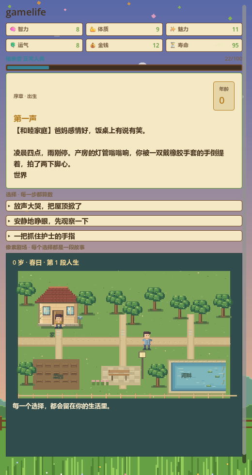
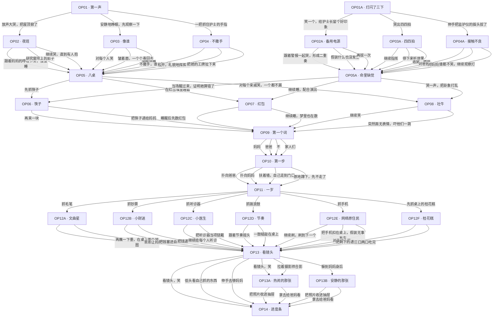

# 开局剧情：序章分支树

> 本文件的剧情数据来自 [`data/story_opening.json`](../data/story_opening.json)，
> 新增的随机事件写入 [`data/game_data.json`](../data/game_data.json) 的 `EVENTS`。
> 两者都存放在 GitHub 仓库 **SL**（`gulegegezi/SL`）中。
> 序章之后的跨年龄段联动剧本见 [story-links.md](story-links.md)。
> 叙事总纲、人物与写作规则见 [story-bible.md](story-bible.md)。
> 可玩的三岁前试玩见 [story-demo-pre3.md](story-demo-pre3.md)。



## 这次增加了什么

- **序章 26 个节点**：从出生到一岁抓周，共 10 个玩家决策点；普通线与抽象线各有独立开头，满月酒另有抽象分支。
- **14 个新的童年/少年随机事件**（C21–C34），每个事件 3 个选项；其中 C21–C32 的选项会进入 **36 个后续节点**（C21A…C32C），形成“选择 → 当天结果 → 之后发生了什么”的两段式分支。
- C33、C34 是序章结束后的 1–3 岁补位事件，保证序章已经抓过周后，日常池里仍有低龄事件，不会立刻重复抓周。
- 合计新增 **76 个剧情节点**、**188 个新选项**、约 1 万字剧情文本，并把“分支树”保存为可校验的 JSON 数据，而不是散落在代码里的 if/else。
- 所有分支都会回到人生随机池，不会卡死；序章播放期间年龄不增长，序章结束的 `OP14` 才把年龄推进到 1 岁。
- 序章 `OP11` 会写入隐藏标签 `_已抓周`，`C01` 抓周的条件里加了 `notTags`，随机池不会在序章后再抽一次抓周。

## 序章怎么走

1. 出生：普通线 `OP01` / 抽象线 `OP01A`，三种反应分别进入第一夜、围观、手劲三条短支线。
2. 满月酒：抓筷子、睡红包、对亲戚笑，分别进入 `OP06` / `OP07` / `OP08`；抽象线走 `OP05A`。
3. 开口与迈步：第一个词、第一步各选一次，选项会留下标签（如“社牛”“认生”“吃货”）。
4. 抓周：六种东西，其中“桂花糕”只在满月酒抓过筷子（`吃货` 标签）时出现。
5. 全家福：`社牛` / `认生` 会进入不同的收尾节点 `OP13A` / `OP13B`，再汇合到 `OP14`。
6. `OP14` 结束后 `ageGain: 1`，年龄变为 1 岁，回到原有的随机人生事件池。

## 序章全文：从第一声到第一张全家福

### 一、第一声（`OP01` / `OP01A`）

**普通线。**

凌晨四点，雨刚停。

产房的灯管嗡嗡响，你被一双戴橡胶手套的手倒提着，拍了两下脚心。世界很亮，很吵，很冷。你有很多话想说，但只会哭。

护士说：肺活量不错。你爸在走廊上听见了，腿一软，差点坐地上。

你第一次面对这个世界，能做的只有三件事：

- **放声大哭，把屋顶掀了。** 你选择让所有人知道：你来了。
- **安静地睁眼，先观察一下。** 你选择先看清楚，再决定要不要哭。护士说这孩子眼神有点深，你妈说随他爸，爱发呆。
- **一把抓住护士的手指。** 你选择先确认：这个世界，抓不抓得住。

**抽象线。**

你出生那天，产房的灯闪了三下，心电监护仪自动播放了一段《好运来》。护士长说：这孩子以后要出大事。你爸当场打开手机，开始查「孩子出生时灯闪三下是什么预兆」。

你笑了，护士长也笑了，然后她默默把监护仪的插头检查了一遍；或者你哭出四四拍，整层楼的婴儿跟着打拍子；或者你伸手把插头拔了，病房安静三秒，备用电源响得比原来还大。你爸说：随我。

这是这个故事第一次开玩笑。它想告诉你：哪怕是最普通的一生，也可以有一个不太普通的开头。

### 二、第一夜 / 围观 / 手劲

普通线的出生选择，会把你送进三条很短的支线。

**第一夜。** 夜里三点，全病房都睡了，你没有。你盯着天花板，像一个刚入职就被安排上夜班的员工。你可以跟着妈妈的呼吸节奏慢慢睡，可以研究窗帘上的影子，也可以继续哭，直到有人抱。你妈抱着你在走廊走了四十分钟，你爸在病房里睡得很香。

**围观。** 第二天，亲戚们隔着玻璃看你，像在参观一件刚出土的文物。有人说你像爸，有人说你像妈，还有人说你像隔壁老王。你可以对每个人笑，可以皱着眉一个个看回去，也可以闭眼装睡。亲戚们压低声音说：这孩子真乖。其实你只是在保存体力。

**手劲。** 护士说这孩子手劲真大，你攥着她的手指攥了十分钟。你可以不撒手，可以礼貌地挥挥手，也可以把她的工牌扯下来。工牌掉在你脸上，你盯着上面的照片看了很久——那是你人生第一次认人。

### 三、满月酒（`OP05` / `OP05A`）

满月酒摆了八桌，来的亲戚比预想的多一倍。你被轮流抱着，像一件刚到的快递。有人往你手里塞红包，有人往你嘴里塞筷子。

- **先抓筷子。** 你准确戳进了那盘红烧肉。全场安静一秒，然后爆发出一阵大笑。你二姨说：这孩子以后不愁吃。你爸说：主要是随我。你妈说：你先把那盘红烧肉放下再说话。
- **在红包堆里睡着。** 你枕着三个红包，口水打湿了其中两个。你妈默默把湿的那两个收进了自己包里。
- **对每个亲戚笑，一个都不漏。** 亲戚们纷纷加你妈的微信，说要给你介绍对象。你才一个月大。

抽象线的满月酒另有版本：你二姨非要给你算一卦，说你命里缺觉。你可以当场醒过来拆她的台，可以继续睡配合演出，也可以哭一声把卦象打乱。她说：变了，这孩子命里缺钱。你妈说：这不用算。

### 四、第一个词（`OP09`）

十个月大，你终于开口了。全家人围成一圈，屏住呼吸，等你说出人生第一个词。

- **妈妈。** 你妈当场哭了。你爸说：那我呢？你看了他一眼，说：饭。
- **爸爸。** 你爸把你举过头顶，说：好儿子。你妈说：我天天喂奶，他先叫你？你爸说：可能是我比较帅。
- **不。** 全家人愣住。你奶奶说：这孩子有主见。你妈说：完了，以后不好管。
- **家人们（抽象线）。** 你妈说：他刚才是不是说了家人们？你爸说：别学我刷短视频。

第一个词不是预言。它只是这个家往后十几年饭桌上会反复提起的一个笑话。

### 五、第一步（`OP10`）

一岁生日前，你扶着沙发站起来。所有人都停下筷子看你。你面前有三条路：爸爸张开的手，妈妈举着的玩具，还有一扇没关严的门。

- **扑向爸爸。** 你爸接住你，笑得像个孩子。你妈说：行吧，算你有良心。
- **扑向妈妈。** 你妈把你抱起来转了一圈。你爸在旁边张开手，说：那我呢？没人理他。
- **扶着墙，自己走到门口。** 你走到门口，回头看了他们一眼。你妈说：这孩子以后是不是要走很远。你爸说：先把门关上。
- **原地蹲下，先不走了。** 你蹲下研究地板缝。亲戚们说：这孩子稳重。你妈说：他就是懒。

这一步不代表你以后会走多远。它只代表，你第一次自己决定要去哪里。

### 六、抓周（`OP11`）

一岁生日，家里在桌上摆了一圈东西：算盘、毛笔、钞票、听诊器、拨浪鼓，还有一部亮着屏的旧手机。亲戚们围成一圈，比你还紧张。

- **抓毛笔。** 你抓起毛笔，先往嘴里送。亲戚们说：这是要当文曲星。你妈说：先把他嘴里的墨洗了。
- **抓钞票。** 你攥得比谁都紧。你爸说：这孩子随我。你妈说：你爸当年抓的是算盘，现在算盘在哪？
- **抓听诊器。** 你往自己胸口一按，又去按你爸的。你爸说：以后家里看病有人了。
- **抓拨浪鼓。** 你摇出了全场唯一的节奏。你奶奶当场扭了两步，被你爷爷拉住了。
- **抓手机。** 你大拇指准确地点开一个短视频，声音外放：家人们，谁懂啊。全场沉默。
- **先抓桂花糕（隐藏）。** 只有满月酒抓过筷子的人，才会越过所有象征未来的东西，抓住那块桂花糕。你二姨说：这孩子活得明白。

抓周不是命运的分岔口。它更像一面镜子：一桌大人把自己对未来的想象，摆在了你面前。你抓了什么，他们就顺着什么，开始讲你以后会成为谁。

### 七、全家福（`OP13`）

抓周结束，摄影师让你们看镜头。你被抱在中间，身后是笑得有点僵的爸妈，桌上是你刚抓的东西。快门按下的前一秒，你突然意识到：这一桌人，以后要陪你走很久。

- **看镜头，笑。** 你笑得很标准。摄影师说：这孩子上镜。
- **低头看自己抓的东西。** 你低头看了很久。摄影师抓拍到了这个瞬间，后来这张照片一直放在你家的柜子上。
- **伸手去够妈妈。** 你抓住妈妈的衣领。摄影师说：别动，这张好。

如果你在满月酒上是个「社牛」，摄影师会被你拉着合影，照片里你笑得最大声；如果你是个「认生」的孩子，你会躲到妈妈身后，照片里只露出半张脸。多年后你翻到这张照片，会发现妈妈的手一直护在你背后。

### 八、序章完（`OP14`）

照片洗出来，你被放在床头。

从明天起，你会走路、说话、上学、长大、离开、回来。

人生的进度条，正式开始了。

你可以闭上眼睛睡一觉，梦见有人在叫你的名字，你答应了，但不知道是谁；也可以睁大眼睛看看这个世界，直到天亮，窗外的光一点一点漫进来，像有人慢慢推开一扇门。

序章到此结束。接下来的一岁、十岁、二十岁、四十岁、六十岁，都不会再有人替你摆好一桌东西。你要自己选。

## 分支树



上图为序章主干；`C21–C34` 的选项与后续节点见下表（C33/C34 不接后续）。

## 随机事件 → 后续节点

| 事件 | 选项 → 后续节点 |
| --- | --- |
| C21 幼儿园第一天 | 主动走过去，把饼干分给最近的小朋友 → C21A<br>抱着妈妈的腿不撒手 → C21B<br>蹲在角落，观察谁最先不哭 → C21C |
| C22 同桌的秘密 | 把纸条收进笔盒，什么也不问 → C22A<br>告诉他：我爸妈也吵过架 → C22B<br>偷偷告诉老师 → C22C |
| C23 家长会 | 主动交代最近一次考试 → C23A<br>把成绩单藏进书包夹层 → C23B<br>让同桌冒充家长 → C23C |
| C24 第一次考砸 | 自己拿红笔改成88 → C24A<br>回家坦白 → C24B<br>把卷子折成纸飞机 → C24C |
| C25 春游走散 | 按老师教的，站在原地等 → C25A<br>自己沿着来路找回去 → C25B<br>找工作人员广播 → C25C |
| C26 合唱团 | 认真练，争取领唱 → C26A<br>在台上发呆 → C26B<br>假装嗓子疼 → C26C |
| C27 自行车 | 学 → C27A<br>拒绝 → C27B<br>趁爸妈不注意，偷偷骑走 → C27C |
| C28 暴雨 | 把伞给他 → C28A<br>自己撑伞回家 → C28B<br>拉他一起撑 → C28C |
| C29 一千米 | 跟着第一梯队跑 → C29A<br>按自己的节奏跑 → C29B<br>装肚子疼 → C29C |
| C30 晚自习停电 | 拿出手机，加入光源 → C30A<br>趴在桌上睡觉 → C30B<br>和同桌小声聊天 → C30C |
| C31 手机被没收 | 当场认错，争取宽大处理 → C31A<br>放学后去办公室偷回来 → C31B<br>接受现实，开始用老年机 → C31C |
| C32 毕业留言册 | 认真给每个人写一段 → C32A<br>只写一句：后会有期 → C32B<br>在最后一页画了一幅画 → C32C |
| C33 一岁半的午后 | 伸手够出来 → （不接后续）<br>叫妈妈来帮忙 → （不接后续）<br>继续往里爬 → （不接后续） |
| C34 两岁的雨 | 数一数有几颗 → （不接后续）<br>拍窗户，跟水珠打招呼 → （不接后续）<br>继续发呆 → （不接后续） |

## 标签与条件

序章和新增事件会写入以下标签，标签会显示在顶栏，也会影响后续分支：

| 标签 | 来源 | 作用 |
| --- | --- | --- |
| 社牛 | `OP03` / `OP05` | 满月酒、全家福走热闹分支；`OP09` 出现“家人们” |
| 认生 | `OP03` | 全家福出现“躲到妈妈身后”，进入 `OP13B` |
| 吃货 | `OP05` 抓筷子 | 抓周出现隐藏选项“先抓桌上的桂花糕” |
| 财迷 | `OP05` 睡红包 | 后续剧情文本变化（`OP07`） |
| 观察者 / 好奇 / 倔 / 随和 | 序章短支线 | 角色气质，供后续事件与成就扩展 |
| 守口如瓶 / 共情 / 告老师 | `C22` | 同桌秘密的三条后续线 |
| 会分享 / 粘人 / 勇敢 / 仗义 | 新增事件 | 童年性格标签 |

## 数据格式

序章节点与普通事件使用同一套字段，额外支持：

```json
{
  "id": "OP13",
  "title": "看镜头",
  "text": "……",
  "stage": "prologue",
  "choices": [
    {
      "label": "看镜头，笑",
      "effects": {"charm": 2},
      "tags": ["上镜"],
      "result": "……",
      "next": {
        "default": "OP14",
        "when": [{"tags": ["社牛"], "next": "OP13A"}]
      }
    }
  ]
}
```

- `next` 可以是字符串，也可以是 `{"default": "...", "when": [...]}`；条件支持 `tags`、`notTags`、`line`、`minInt` 等。
- `showIf` / `hideIf` 控制选项是否出现（例如隐藏的桂花糕选项）。
- `ageGain` 只在队列清空后生效；`OP14` 用它把年龄从 0 推到 1。
- 分支后续节点放在 `story_opening.json` 的 `nodes` 中，`stage` 为 `branch`，不会进入随机池。

## 验证

```bash
godot --headless --path . --script res://test/opening_smoke.gd
godot --headless --path . --script res://test/opening_ui_smoke.gd
godot --headless --path . --script res://test/story_smoke.gd
godot --headless --path . --script res://test/room_sequence_smoke.gd
godot --headless --path . --script res://test/ui_progress_smoke.gd
godot --headless --path . --script res://test/world_smoke.gd
```

`opening_smoke.gd` 会检查：所有 `next` 目标存在、序章全部可达、至少 20 个序章节点、
不同选择能走不同分支、序章期间年龄不变、结束后年龄推进到 1 岁。
`opening_ui_smoke.gd` 会实际实例化 Main：开始人生后先出现 OP01，选择后进入 OP02，
并验证序章内继续按钮不会推进年龄。
