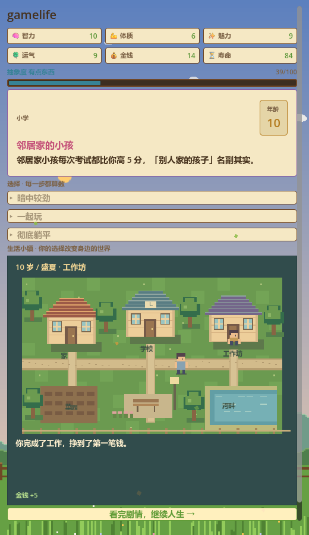

> 此版本已升级为持续演进的小镇，当前实现与验证请看 [生活小镇说明](life-town.md)。以下保留初版短剧说明。

# 草图 UI 与像素剧情演出

使用 Godot 4 打开仓库根目录的 project.godot，运行 Main 场景。

布局从上到下为数值、事件（右侧年龄）、选项、人生剧场。保留现有六项属性、抽象度和人生事件规则。选择只结算一次；3.2 秒演出完成后，点击“看完剧情，继续人生”进入下一事件。结果文本持续保留，长页面会自动滚动至剧场。

小人为 Godot 整数像素网格绘制，场景包括学习、工作、运动、社交、失意、休息、庆祝、前行。动作由选项与结果关键词匹配，再按属性变化兜底；这是规则化短剧，并非任意文本生成动画。数据选项可使用 story 字段明确指定 study/work/sport/social/sad/rest/celebrate/walk。

道具复用本 SL 仓库 assets/vfx 中已有的 coin、heart、spark、muscle、clover PNG，既有来源记录为 PixelSRPG-Forge。没有引入外部运行时或远程素材依赖。

## 验证

Godot 4.7.2：编辑器导入、headless 自动检查、OpenGL 实际渲染均通过。自动检查运行命令：

```
godot --headless --path . --script res://test/story_smoke.gd
```

覆盖八类演出、选项关键词、重复点击保护、演出完成门控与推进事件。非 headless 模式会将画面保存为 docs/story-stage-preview.png（自动测试使用固定工作选项展示演出）。测试退出时引擎仍报告少量 CanvasItem/ObjectDB 释放警告，不影响断言通过；此项尚未消除。


