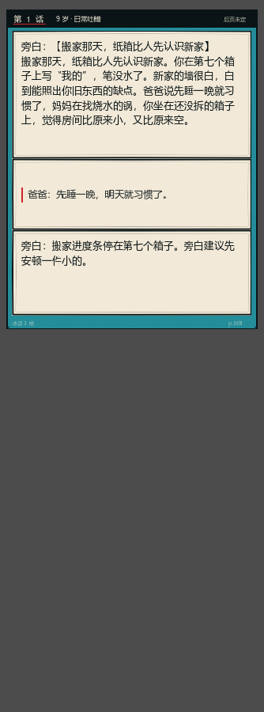

# 文字更显眼：文本页与纯文本叙事

> 针对「文字不够显眼、装不下、必要时可以纯文本」做的一轮：
> 普通分格的字号与气泡测量修正 + 新增 **presentation = "text"** 的纯文本页。
> 目前用在前 30 岁的两个长文本事件：LC29 搬家、LC30 父亲的手机。



## 一、普通分格：字更清楚

| 改动 | 之前 | 现在 |
| --- | --- | --- |
| 气泡字号 | 13 / 11 | **14** / 11 |
| 气泡高度测量 | 固定按 13 算（小格会溢出） | 按实际字号算 |
| 旁白框 | 15px（窄格 11/10） | 保持，但对白色纸底加了对比 |

## 二、纯文本页

`presentation: "text"` 时不再画 3D：

- **奶油纸底 + 墨字**（不是青绿底），长文对比度更高；
- 字号按宽度 15–20px，行距 `字号 + 9`，段落按宽度手动折行；
- 引文（气泡内容）左侧加一条红杠，字号略小；
- 标题与正文重复时自动去掉标题，避免同一句话出现两遍。

渲染在 `comic_panel._draw_text_page()`，折行在 `_wrap_lines_manual()`。

## 三、容量

`comic_page._webtoon_slots()` 对文本页单独估高：

```gdscript
var cols := maxf(12.0, (maxf(size.x, 280) - 56.0) / 18.0)
base = 140.0 + maxf(0.0, ceilf(text_length / cols) - 1.0) * 28.0
```

也就是说：**字越多，格子越高**，不会把文字裁掉；普通页仍按原来的 21px/行估算。

## 四、两个纯文本事件

| id | 年龄 | 文本量 | 内容 |
| --- | --- | --- | --- |
| LC29 | 9–13 | 约 120 字开场 + 每格 | 搬家那天，纸箱比人先认识新家 |
| LC30 | 14–17 | 约 110 字开场 + 每格 | 父亲的第一部手机，只会接不会打 |

每个都带 3 个选项、四档 `lenses`、结果页三格；`text_only: true` 写在事件上，
生成页面时整页转文本格，并跳过漫画插页（`_apply_insert` 会提前返回）。

老存档升级（`upgrade_legacy`）也会保留文本页，不会被打回 3D。

## 五、验证

```bash
python tools/check_story.py
godot --headless --path . --script res://test/text_mode_smoke.gd
# PASS: text-only pages LC29/LC30 carry enough text
godot --headless --path . --script res://test/story_roast_smoke.gd
# PASS: 9 choice roasts, roast reaches the result page
```

`text_mode_smoke` 断言：两个事件整页都是 text、有标题、正文合计 ≥120 字；
普通页（LC01）不得被误标成文本页。

## 六、顺手带上的依赖

`comic_panel.gd` 里出现了并行会话新增的 `const Dialogue := preload("res://scripts/comic_dialogue.gd")`，
为了不让仓库编译不过，这个 38 行的对话模板也一起提交了（它只做「名字：台词」的显示拆分）。

## 七、还能再做

- 文本页的**字号随设备宽度**再细分（手机竖屏 15px 偏小，可到 17px）。
- 文本页支持**分段小标题**（现在只有第一格有标题位）。
- 普通页的旁白框仍可能在小格压到脸，需要按角色高度动态避让。
