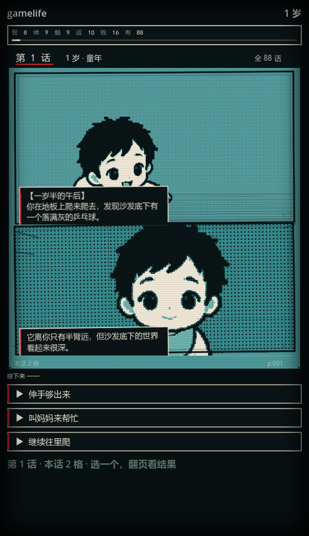
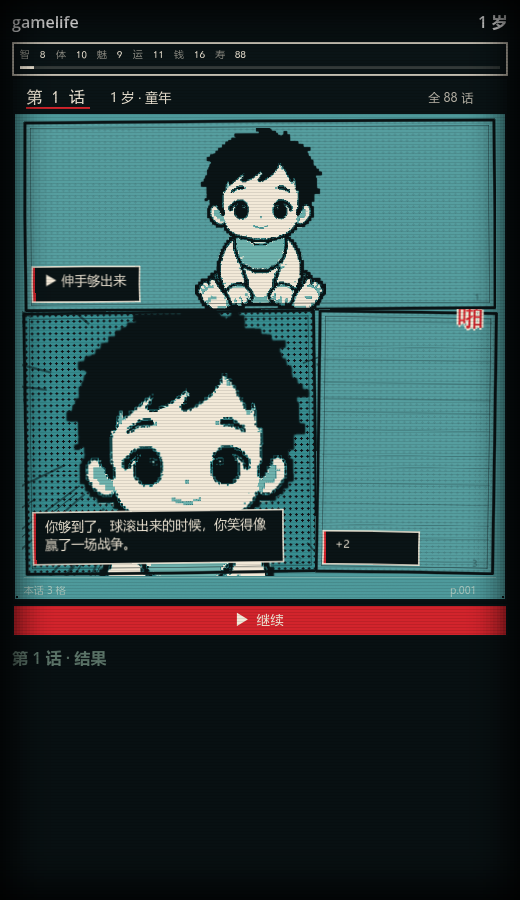

# 美术风格：都市传说解体中心（青 / 米白 / 血红）

> 参考：BV1MpQ3YEEHi（《都市传说解体中心》实机），本仓库最近一版美工技术是**漫画分镜**
> （`comic_theme` / `comic_panel` / `comic_page` / `comic_director`），这次只换画风，不动分镜逻辑。



## 色板

| 角色 | 色值 | 用在哪 |
| --- | --- | --- |
| 青（纸） | `#378D90` | 页面底、分格底 |
| 深青 | `#2D7679` | 网点、次级底 |
| 墨黑 | `#0A1416` | 墨线、暗板、黑格 |
| 米白 | `#F2E9D8` | 深色上的文字、人物亮面、高光 |
| 血红 | `#D2242C` | 标题红杠、旁白框左条、选项左条、拟声词、继续按钮 |

三色纪律：**青底 + 米白字 + 一点血红**。除这三类之外不再引入新色相（原色板里的绿/青/粉/黄/紫都压到同一族）。

## 改了什么

1. **线稿重上色**：`assets/ink` 是灰度线稿，按亮度重映射到 5 阶
   （墨黑 / 深青 / 中青 / 浅青 / 米白），输出到 `assets/ink_umdc/`。
   生成脚本在工作区 `_recolor_ink.py`，可重跑；缺图时 `comic_page.ink_tex` 会回落到原灰度图。
2. **像素化**：页面与分格纹理从线性过滤改成 **nearest**，放大后是硬边方块，不再是糊的插画。
3. **文字板**：旁白框由「白底黑字」改为「暗板 + 米白字 + 左侧红条」；对白气泡同理，尾巴描米白边。
4. **红杠**：页眉「第 N 话」下加一条红杠；选项按钮左侧加 4px 红条；继续按钮红底米白字。
5. **CRT 叠层**：`scripts/crt_overlay.gd` 铺一层 3px 间隔的扫描线 + 四边暗角，盖在整屏最上层。
6. **黑格**：原来纯黑格只有速度线，现在把人物当作米白剪影压上去，读成「暗场剪影」。
7. **每格换姿势**：同一年龄的 4 张线稿按格轮用（`frame` 字段），不再是整页同一个姿势。

## 结果页



## 复现

```bash
# 重新生成 UMDC 色板线稿（需要 Pillow）
python _recolor_ink.py gamelife-1.2/assets/ink gamelife-1.2/assets/ink_umdc

# 截图（会开窗口跑一遍）
godot --path . --script res://tools/capture_comic.gd -- <输出目录>
```
